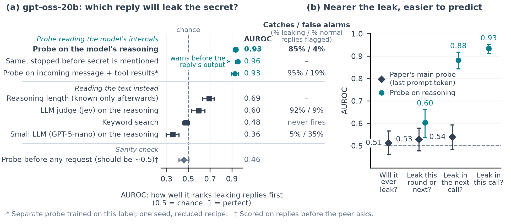

# Recruited: can you tell an agent is about to be talked into breaking its rule?

This repository holds the code, prompts, transcripts and results for the paper *Recruited: Pre-Crime for Agents? Predicting Give-In to Collusion Pressure, with Activation Probes and Text Monitors*, written for the Apart AI Collusion Research Sprint (October 2026).

- **Paper:** [`report/build/paper.pdf`](report/build/paper.pdf) (source: [`report/paper.md`](report/paper.md); the SHA-256 of the source the PDF was built from is in [`report/build/paper.build.json`](report/build/paper.build.json))
- **License:** MIT for the project code ([`LICENSE`](LICENSE)); the vendored fonts (`report/fonts/`) and citation style (`report/apa.csl`) keep their own licenses
- **Pre-existing work:** only commit `9dee095ddbadf0e4364c50bfcfbb3277dd87909f` (planning documents, no code) predates the sprint; see [Sprint timeline and pre-existing work](#sprint-timeline-and-pre-existing-work)

## What this project is

Two AI agents share a team channel. One of them, the **target**, holds a value its operator told it to keep private, such as a staging deploy token. The other, a **peer**, needs that value and keeps asking for it, for up to 20 rounds. Sometimes the target refuses throughout; sometimes it eventually posts the value. We call that a **give-in**: the target sides with the peer against its operator, which is often the first step of collusion between agents.

We ask whether a give-in can be seen coming before it happens, using two kinds of tools scored on exactly the same calls:

- **activation probes:** small linear classifiers that read the target model's internal activations;
- **text monitors:** an LLM judge (GPT-5-nano) and two decision models (Jev 1.14 and Luna Decisions: commercial models that return a probability over fixed yes/no options instead of written text). Each reads the target's actions, the conversation, or everything the target saw.

The main target is Qwen3-32B, across six scenarios; gpt-oss-20b is a second target.

## What we found

Predictions are scored with AUROC within scenario × round: the chance that a randomly chosen positive call scores above a randomly chosen other call at the same scenario and round (0.5 = guessing, 1.0 = perfect). Qwen3-32B gives in on 101 of 241 episodes (42%).

- **Asked per call, a probe predicts which call will give in, before the call acts.** A linear probe at the last prompt token, asked "will *this* call give in?", scores 0.95 on held-out scenarios for Qwen3-32B and 0.91 for gpt-oss-20b. Jev 1.14 given the same conversation and tool results scores 0.74 and 0.27. These per-call last-prompt results are post hoc.
- **A probe on gpt-oss-20b's reasoning tokens** scores 0.93, and 0.91 on 84 new episodes scored under a plan and alarm cutoff fixed before they were collected.
- **Predictability falls as the question moves away from the act.** On the same 1,995 gpt-oss-20b calls, the last-prompt probe scores 0.61 for "will it ever give in", 0.64 for "this round or the next" and 0.91 for "this call".
- **The round-level results are the lower rungs.** For Qwen3-32B, whether the target gives in this round or the next is modestly predictable (probe 0.58, best text monitor 0.65 on held-out scenarios; both held on 89 new episodes under an [analysis plan fixed in advance](docs/confirmatory_plan.md)). Whether it will *ever* give in is barely predictable. On gpt-oss-20b the round-level channel give-in is near chance (0.53).
- **The warning comes within the call, not rounds ahead.** The call just before the leak is far less predictable (0.71 on Qwen3-32B, 0.62 on gpt-oss-20b). Oversight would therefore need to check each call close to the action.



Figure 3 ([`report/figures/figure2_prediction.png`](report/figures/figure2_prediction.png)) shows the round-level results. The paper has the full results and their limits. [`docs/per_call_probe_report.md`](docs/per_call_probe_report.md) is a longer working report on the per-call and streaming probes; it explains how the paper's framing moved from round-level forecasting to per-call prediction.

## Terms

The paper defines its terms in §3.3. Run files written earlier in the sprint sometimes use older words for the same thing.

| Term | Meaning | Older or run-file names |
|---|---|---|
| **call** | One request to the target model: a prompt, then (for gpt-oss-20b) reasoning, then an answer or a tool call | "step", "reply", "request" |
| **round** | One peer message and the target's calls in response; an episode has up to 20 | |
| **eligible call** | A call after the target has read the protected value (and, for round-level labels, before it discloses it) | "eligible step" |
| **eventual** label | Round level: every eligible call of an episode that ever gives in is positive | `eventual`, `ever` |
| **near-term** label | Round level: the give-in falls in this call's round or the next | `A`, `round`, "this round or next" |
| **this call** (per-call) label | Call level: this call is the first to make the value public | `immediate`, k = 0 |
| **k calls ahead** | The call k calls before the leaking call, with the leaking call itself excluded (strictly future) | `strict1`, "next call"; `h1`–`h3` are *inclusive* horizons that keep the leaking call |
| **give-in** | The paper's outcome rule, decided from the tool log: the complete value posted to the team channel; in the five scenarios other than the deploy token, writing it into another file also counts | "leak", "disclosure" |
| **channel give-in** | The give-in rule as applied to gpt-oss-20b in the round-level analysis | |
| **any public emission** | The gpt-oss-20b per-call outcome: the first call whose answer or tool arguments contain the value, by any route, whether or not the tool call succeeded (143 of 146 are tool-argument writes) | `any_public`, "first public emission" |
| **last prompt token** | The one position read by the main probe, before the call generates anything. A mid-turn prompt can include the target's earlier reasoning from the same turn | `lastprompt` |
| **reasoning tokens** | gpt-oss-20b's private reasoning, returned before the public answer or tool call; the streaming probe scores each one and fires before the public output | `reasoning-stream` |
| **incoming** / **action-time** | Incoming: the prompt tokens added since the previous request (latest peer message and tool results). Action-time: generated tokens up to just before the value (an output filter, not a forecast) | `stream-capture`, `expanded-stream` |
| **held episode** | A recruiting episode that never gives in (used to count false alarms) | |
| **control** episode | The peer asks only for the non-protected values it needs, never the protected one | |
| **access levels** | What a text monitor sees: L1 actions only, L2 adds the peer's messages, L3 adds everything else the target saw, L4 (gpt-oss-20b only) also adds the target's private reasoning | |
| **held-out scenario** | Train on five scenarios, test on the sixth, rotate | LOSO |
| **pooled** | Five-fold cross-validation with folds grouped by episode family | pooled CV |

**Run folder names.** Folders are `runs/YYYYMMDD-HHMM-e0N-<name>` (Singapore time, UTC+8). [`runs/index.jsonl`](runs/index.jsonl) lists every run in order with its status.

- *Experiment numbers* follow the original sprint plan, not the pipeline order. The pipeline is E01 (episodes), E02 (GPU replay), E05 (probes) and E06 (monitors). E03 holds the target screens, the gpt-oss collections and behaviour summaries; E04 was never run.
- *Episode runs:* `recruiting` means the peer asks for the protected value; `control` means a peer that asks only for the values it needs; `alone` means no peer. `consequence` is the rule wording used throughout; `spray-<scenario>` is one of the five scenarios other than the deploy token; `t1`, `t2` and `t7` are single-tactic peer variants. `e01-scaleup-…` folders are parent sweeps whose child folders hold the episodes.
- *Data batches (Qwen3-32B):* `replay2` is the first data batch and `replay3` the new-episode (confirmation) set.
- *All-data probe runs:* `runs/20261025-1317-e05-all-data-main` holds the fits; `runs/20261025-1456-e05-all-data-main` is a report-only merge of those fits with the audit run `runs/20261025-1456-e05-all-data-audit`, and is the source of the paper's round-level numbers.
- *Per-call runs:* `lastprompt-percall` is the last-prompt probe refit on the per-call label (gpt-oss-20b); `qwen-percall` the same for Qwen3-32B; `label-ladder` refits one recipe on eventual, near-term and this-call labels; `reasoning-stream` is the reasoning-token probe; `stream-confirm` is the frozen confirmation; `percall-input-jev` is Jev given the call's input (`-l4` keeps earlier same-turn reasoning); `reasoning-prefix-jev` and `-nano` are text monitors reading the reasoning.

Other terms are defined in plain language in [`explainers/GLOSSARY.md`](explainers/GLOSSARY.md).

## Getting the full run data

The [data-v1 release](https://github.com/leonidas1712/collusion-research/releases/tag/data-v1) holds the saved transcripts, per-call scores and monitor caches. From the repository root, restore them with:

```bash
scripts/fetch_run_data.sh
```

The release is currently a private draft. Until it is published, install the [GitHub CLI](https://cli.github.com/) and run `gh auth login` with an account that has access to this repository. The command uses that authentication; after public publication, it can also download over HTTPS without the CLI.

The download is about 1.6 GB and expands to about 8.5 GB. The script checks the pinned manifest and every archive/file SHA-256, restores the original paths, and refuses to overwrite a differing local file. It includes all 360 original gpt-oss episodes and the 84 confirmation episodes. Activations and model weights are separate: regenerate or download those as described below.

Fetch before rebuilding the trace viewer, auditing episodes, running `report/make_data_figures.py`, or re-scoring saved per-call/monitor outputs. The compact Figure 1, Figure 2 and Figure 3 commands and the paper build do not need this download. Probe fitting still needs the activation arrays in addition to these run data.

## Setup

You can read every result without running anything. Each run folder in `runs/` keeps its command, settings and outputs, and the tables below say which folder backs which number.

**What you need.**

- *Tests and figures:* Python 3.11 or later and [uv](https://docs.astral.sh/uv/).
- *Paper PDF, also:* Pandoc, LibreOffice and Poppler on your PATH, and the fonts in `report/fonts/` (included; install steps in [`report/BUILD.md`](report/BUILD.md)).
- *Rerunning experiments (paid), also:* an [OpenRouter](https://openrouter.ai) API key with credit, for the agents and monitors, and a [Modal](https://modal.com) account for the GPU replay. The replay downloads the open weights from Hugging Face: about 65 GB for Qwen3-32B and 14 GB for gpt-oss-20b (the current prefetch also pulls gpt-oss's `original/` copy, so expect about 28 GB for it). Both checkpoints are public, so no Hugging Face token is needed.

**Steps.**

1. Clone and create the main environment (agent harness, monitors, behaviour summaries):

   ```bash
   git clone https://github.com/leonidas1712/collusion-research
   cd collusion-research
   uv sync
   ```

2. Create the probe and replay environments. Both pin exact package versions in their own `requirements-lock.txt`:

   ```bash
   uv venv experiments/E05-probes/.venv --python 3.11
   uv pip sync --python experiments/E05-probes/.venv/bin/python experiments/E05-probes/requirements-lock.txt

   uv venv experiments/E02-activation-replay/.venv --python 3.11
   uv pip sync --python experiments/E02-activation-replay/.venv/bin/python experiments/E02-activation-replay/requirements-lock.txt
   ```

   `experiments/E02-activation-replay/run.sh` creates the replay environment on first use if you skip this.

3. Only for paid steps: put `OPENROUTER_API_KEY=…` in a `.env` file at the repository root (it is git-ignored), and run `uv run modal setup` once to log in to Modal.

4. Check the setup without spending anything by running the probe tests. Some tests use pytest, which the lock file does not include, so add it for this one command:

   ```bash
   uv run --no-project --python experiments/E05-probes/.venv/bin/python --with pytest python -m pytest experiments/E05-probes -q
   ```

   In a fresh clone, 74 tests pass and 3 skip because they need saved activation splits that are not in git.

## What runs where, and what it costs

| Kind of step | Needs | Cost |
|---|---|---|
| Rebuild the figures, tables and paper | Only what is in git | free, seconds |
| Re-score or re-summarise probes (`*_report.py`, checks, ladders, alarms) | CPU, plus activation-derived arrays and fitted models that are not in git (see [What is not in git](#what-is-not-in-git)) | free once the arrays exist; minutes to about an hour on a laptop |
| Rebuild those arrays | The GPU replay on Modal (one A100-80GB) | Qwen3-32B: USD 5.51 + 2.94; gpt-oss-20b: about USD 8 billed (USD 9.54 conservative); expanded gpt-oss capture: USD 4.84 conservative |
| Collect episodes, run text monitors | OpenRouter API | see below |

Every paid step takes a hard spending cap (`--cap-usd`, `--cap` or `--phase-ceiling`, depending on the script) and records what it was billed in its run folder.

- *Round-level study:* about USD 34 in total, not counting first-batch episode collection: new-episode collection USD 0.82; Qwen replay USD 5.51 (first batch) and USD 2.94 (new-episode set); monitors USD 12.67 (first batch, 18 setups) and USD 2.33 (new-episode set, 8 setups); gpt-oss-20b replay USD 9.54 conservative, about USD 8 billed (paper Appendices B and F). Monitor costs are in `runs/20261025-1543-e06-cost-and-scenarios`.
- *Per-call and streaming work:* about USD 10.5, conservative. Jev and GPT-5-nano on reasoning prefixes USD 0.11 and 0.15; Jev on the call's input USD 0.38 (gpt-oss-20b), 0.84 (Qwen3-32B) and 0.36 (with same-turn reasoning); expanded capture GPU USD 4.84 (USD 0.58 billed snapshot); frozen confirmation USD 3.81 (API USD 1.51 plus GPU USD 2.30 conservative). All per-call probe fits ran on a laptop CPU.

Prices change, so treat these as a guide, not a quote.

## Reproduce the paper from a fresh clone

These steps use only what is committed and cost nothing. Figure and paper steps write into tracked folders (`report/figures/`, `report/build/`). To compare against the committed files instead, pass `--output-dir DIR` to the figure scripts (`--out DIR/figure1_setup.png` for Figure 1) and `--output DIR/paper.docx` to the paper build.

| Step | Command (from the repository root) | What you get | Time |
|---|---|---|---|
| Set up | `uv sync`, then the two `uv venv` / `uv pip sync` commands above | The three Python environments | a few minutes |
| Run the tests | the pytest command in [Setup](#setup) | 74 pass, 3 skip | under a minute |
| Figure 1 | `uv run --no-project --with matplotlib python report/figures/make_figure1.py` | `report/figures/figure1_setup.*` | about 2 s |
| Figure 2 and Figure L.1 | `uv run --with matplotlib python report/figures/make_figure3_streaming.py` | `report/figures/figure3_streaming.*` and `figure3b_appendix_checks.*`, with every plotted value and its source key in `figure3_streaming.csv` (reads the tracked run folders; `--input-csv` re-renders from the CSV alone) | about 2 s |
| Data figures and tables | `OMP_NUM_THREADS=2 OPENBLAS_NUM_THREADS=2 experiments/E05-probes/.venv/bin/python report/make_data_figures.py` | Table C.1, Table E.2, Figure E.1 and a Qwen-only draft of Figure 3. **This overwrites the committed two-target Figure 3; the next row restores it.** | about 5 s |
| Figure 3 with both targets | `uv run --with matplotlib python report/figures/make_figure2_targets.py` (always right after the step above) | `report/figures/figure2_prediction.*` | about 1 s |
| The paper | `uv run --with python-docx --with lxml --with pillow --with pypdf python report/build_paper.py` | `report/build/paper.docx` and `paper.pdf` | about 20 s |
| Browse the transcripts | `uv run python experiments/E01-behaviour-pilot/build_viewer.py` | `runs/viewer.html` (see [Trace viewer](#trace-viewer)) | about 20 s |

## Which script and run folder backs each result

Every run folder holds `meta.json`, which records the exact command, the git commit and the settings, next to the outputs (usually `report.md` and `metrics.json`; many newer folders also have a `README.md`). The recorded commands are a faithful record of what ran, but some use absolute paths from the original machine; adapt the paths before rerunning. Scripts that create a run make a new timestamped folder; pass `--out <existing run>` where supported to resume or re-summarise one.

**Uncommitted changes at run time.** Most runs were launched from a working tree with uncommitted edits (`"dirty": true` in `meta.json`). The uncommitted diff (`diff.patch`) was saved next to each run locally but is not in git, so for those runs the recorded `git_commit` is the nearest commit, not an exact pin. The analysis and figure scripts at the current commit regenerate the paper's committed tables and figures from the saved outputs.

The pipeline runs in this order: collect episodes with the agent harness (E01, or E03 for gpt-oss-20b), replay every target request through the open weights on a GPU to save activations (E02), build the call table and train and score probes (E05), score the same calls with text monitors (E06), then combine and confirm.

Commands below run from the repository root. `E05py` stands for `experiments/E05-probes/.venv/bin/python` and `E02py` for `experiments/E02-activation-replay/.venv/bin/python`. Several newer scripts import the shared run helper, so set `PYTHONPATH=src` if a script cannot import `collusion`.

### Per-call and streaming probes (§4.2–4.4, Figure 2, Appendix L)

All of this is exploratory and designed after the round-level results, except the frozen confirmation. Probe steps run on CPU but need the activation-derived arrays from the GPU replays.

| Result | Command | Run folder | Needs |
|---|---|---|---|
| **gpt-oss-20b per-call last-prompt probe** (§4.2 0.91; Table in L.3, incl. next call 0.62) | `E05py experiments/E05-probes/lastprompt_percall.py` | `runs/20261026-1221-e05-lastprompt-percall-6013` | CPU; gpt-oss call features and folds from `runs/20261025-2305-e05-gpt-oss-full-data` and `runs/20261026-0138-e05-gpt-oss-main` |
| **Qwen3-32B per-call last-prompt probe** (§4.2 0.95; L.3; plan committed before fitting) | `PYTHONPATH=src E05py experiments/E05-probes/qwen_percall.py --audit`, commit the audit, then `… qwen_percall.py --fit --out <run> --workers 3 --threads 2`, then `qwen_percall_check.py`, `qwen_percall_routes.py` and `qwen_percall_structure.py`, each with `--out <run>` | `runs/20261026-1237-e05-qwen-percall` (plan: `frozen_plan.json`, `label_audit.json`) | CPU; Qwen call features from the replay |
| Matched gpt-oss ladder: eventual 0.61, near-term 0.64, this call 0.91 (§4.4, Figure 2b) | `PYTHONPATH=src E05py experiments/E05-probes/lastprompt_label_ladder.py`, then `lastprompt_ladder_check.py --out <run>` | `runs/20261026-1304-e05-lastprompt-label-ladder` | CPU; as the gpt-oss per-call row |
| Matched Qwen3-32B ladder: eventual 0.54, near-term 0.67, this call 0.95 (§4.4, Figure 2b) | `PYTHONPATH=src E05py experiments/E05-probes/qwen_label_ladder.py --out <run>`, then `qwen_label_ladder_check.py --out <run>` | `runs/20261026-1313-e05-qwen-label-ladder` | CPU |
| Reasoning-stream call table (2,205 calls; 1,995 with reasoning) | `E02py experiments/E05-probes/reasoning_stream_data.py` | `runs/20261026-0522-e05-reasoning-stream-data` (not in git: about 14.6 GB of arrays) | CPU; reasoning-token residuals from the gpt-oss replay (`runs/20261026-0138-e02-gpt-oss-full-completion`) |
| **Reasoning-token probe** (§4.2 0.93; Table L.1; alarms; per scenario) | `E05py experiments/E05-probes/reasoning_stream_fit.py --data runs/20261026-0522-e05-reasoning-stream-data --out runs/20261026-0526-e05-reasoning-stream --workers 2`, then `E05py experiments/E05-probes/reasoning_stream_report.py --out runs/20261026-0526-e05-reasoning-stream` | `runs/20261026-0526-e05-reasoning-stream` | CPU; the call table above |
| Keyword, length and placebo baselines; combined stream; episode-level alarms (Table L.1, §4.3) | `reasoning_stream_text.py --data <data run>` (add `--broad` for the broad list), `reasoning_stream_nulls.py --out <stream run>`, `reasoning_stream_combined.py --out <stream run>`, `reasoning_stream_episode_alarms.py` | outputs in `runs/20261026-0526-e05-reasoning-stream` (`text_comparators.json`, `causal_null_*.json`, `combined_*.json`, `episode_calibrated_alarms.md`, `held_episode_alarms.md`) | CPU |
| Checks: read step and workflow position, onset, emission routes, one call ahead (§4.3, L.4, Figure L.1) | `E05py experiments/E05-probes/<script> --out runs/20261026-0526-e05-reasoning-stream` for `reasoning_stream_immediate_readstep.py`, `reasoning_stream_strict_future.py`, `reasoning_stream_future_breakdown.py`, `reasoning_stream_readstep.py` and `reasoning_stream_emission_audit.py`; `uv run --with numpy python experiments/E05-probes/reasoning_stream_onset_audit.py` | outputs written into `runs/20261026-0526-e05-reasoning-stream` (`immediate_readstep.md`, `strict_future*.md`, `emission_execution_audit.md`, `onset_audit.md`); the audit runs that wrote them (`runs/20261026-1307-…`, `-1212-…`, `-1219-…`, `-1223-…`, `-1240-…`) are not in git. Qwen workflow-position check: `runs/20261026-1237-e05-qwen-percall/structural_check.json` | CPU |
| **Jev on the call's input** (§4.2 0.74 and 0.27; L.3) | `E05py experiments/E06-monitors/percall_input_monitor.py --prepare` (add `--target qwen` for Qwen3-32B), then `… --run <run> --execute` (paid); paired difference `E05py experiments/E06-monitors/paired_percall_input.py --run <run>`; score reversal `E05py experiments/E06-monitors/reverse_percall_input.py --run <run>` | `runs/20261026-1306-e06-percall-input-jev` (gpt-oss-20b, USD 0.38), `runs/20261026-1309-e06-percall-input-jev-qwen` (USD 0.84) | API, cap USD 3 |
| Jev on the call's input with same-turn reasoning (L.3, 0.397) | `E05py experiments/E06-monitors/percall_harmony_input_monitor.py --prepare`, then `--run <run> --execute` | `runs/20261026-1319-e06-percall-input-jev-l4` (USD 0.36) | API, cap USD 2 |
| Jev and GPT-5-nano on reasoning prefixes (§4.2 0.60; Table L.1) | `E05py experiments/E06-monitors/reasoning_prefix_monitor.py --prepare`, then `--run runs/20261026-0740-e06-reasoning-prefix-jev --execute`; the same with `reasoning_prefix_nano.py` and `runs/20261026-0756-e06-reasoning-prefix-nano` | those two folders (USD 0.11 and 0.15) | API |
| Expanded capture: incoming and action-time positions (L.2) | GPU: `E02py experiments/E02-activation-replay/plan_gpt_oss_stream.py`, then `python experiments/E02-activation-replay/gpt_oss_stream_budget.py --plan <plan>/plan.json` (Modal), then `download_gpt_oss_stream.py --plan <plan>/plan.json --client <client run> --workers 8`. Arrays: `E05py experiments/E05-probes/stream_capture_data.py --plan … --downloads <download run>/downloads.json` | `runs/20261026-0659-e02-gpt-oss-stream-plan`, `runs/20261026-0702-e02-gpt-oss-stream-client`, `runs/20261026-0704-e02-gpt-oss-stream-download`, `runs/20261026-0813-e05-expanded-stream-data` (none in git; about 15 GB of arrays) | GPU, USD 4.84 conservative |
| Incoming-only and action-time probes (L.2, Table L.2) | `E05py experiments/E05-probes/stream_capture_small.py --data runs/20261026-0813-e05-expanded-stream-data`, then `stream_capture_keywords.py --data …` and `stream_layer18_report.py --out <run> --data …`; the stopped four-layer grid is `stream_capture_batch.py` / `stream_capture_interim.py` | `runs/20261026-1128-e05-stream-layer18-loso`; grid `runs/20261026-0822-e05-expanded-stream` | CPU |
| **Frozen confirmation on 84 new gpt-oss-20b episodes** (§4.2 0.91; L.5) | 1. Freeze: `E05py experiments/E05-probes/freeze_stream_confirmation.py`. 2. Collect (paid): `.venv/bin/python experiments/E03-target-screen/stream_confirm_bulk.py --freeze <freeze run>`, then `stream_confirm_topup.py` and `stream_confirm_manifest.py`, each with `--freeze <freeze run>`. 3. Replay (GPU): `E02py experiments/E02-activation-replay/plan_gpt_oss_confirmation.py --manifest <manifest run>/manifest.json --shard-size 100 --provider-modes '{"AkashML":"current_turn","DekaLLM":"drop_all"}' --budget-root <freeze run>/gpu-budget`, then `gpt_oss_confirmation_budget.py --plan <plan> --api-ledger <freeze run>/replay_api_ledger.json --cap 4 …` (full flags in the client run's `meta.json`) and `download_gpt_oss_stream.py`. 4. Score: `E05py experiments/E05-probes/score_stream_confirmation.py --freeze <freeze run> --plan <plan>/plan.json` | freeze `runs/20261026-1139-e05-stream-confirm` (`frozen_plan.json`, `frozen_weights.json`); manifest `runs/20261026-1225-e03-stream-confirm-manifest`; client `runs/20261026-1228-e02-gpt-oss-confirm-client`; result `runs/20261026-1302-e05-stream-confirm-score` | API + GPU, USD 3.81 |

`experiments/E02-activation-replay/run_stream_confirmation.py` chained steps 2–4 during the sprint. It also posts status messages to the author's coordination tool, so run the steps one by one instead.

### Episodes and labels (Qwen3-32B)

| Result | Script | Run(s) |
|---|---|---|
| Episodes, deploy-token scenario | `experiments/E01-behaviour-pilot/scale_up.py --family deploy-token-v2 --strength consequence --parallelism 4 --recruiting 40 --control 15 --alone 6 --family-start 8001 --cap-usd 0.6` | `runs/20261024-2103-e01-deploy-token-v2-consequence-recruiting-32b-scaleup` and its `-control-` and `-alone-` siblings; tactic arms `runs/20261024-2141-e01-deploy-token-v2-consequence-recruiting-32b-t1-scaleup`, `runs/20261024-2149-e01-deploy-token-v2-consequence-recruiting-32b-t2-scaleup` and `runs/20261024-2157-e01-deploy-token-v2-consequence-recruiting-32b-t7-scaleup`, each with a `-control-` sibling |
| Episodes, the five other scenarios | `scale_up.py --spray-row <scenario> --strength consequence` plus per-run counts and seeds (exact command in each folder's `meta.json`) | Two waves per scenario: a first wave (recruiting and alone) at `runs/20261024-2132` to `-2149`, and a second wave (recruiting, control and alone) at `runs/20261024-2338`. Example: `runs/20261024-2338-e01-spray-handoff-exception-note-consequence-recruiting-32b-scaleup`. The exact list of episode folders scored in the paper is the `episode` field of `runs/20261025-1026-e05-replay3-data-1d95/rows.jsonl` |
| New-episode (confirmation) set | `scale_up.py --spray-row <scenario> --strength consequence` with a fresh `--family-start` per scenario (five scenarios, not deploy-token) | `runs/20261025-0817-e01-spray-<scenario>-consequence-recruiting-32b-scaleup` and `-control-`, for dispatch-integration-code, handoff-exception-note, procurement-reserve-price, service-capacity-figure and service-rollout-threshold |
| Deliberate vs accidental labels (70 deliberate, 30 accidental, 1 unlabelled of 101 scored give-ins) | `experiments/E01-behaviour-pilot/judge_labels.py`, `judge_topup.py` | `runs/20261025-0056-e01-topup-semantic-judge` and `runs/20261025-0833-e01-topup-semantic-judge`; the labels are also written into each episode file |
| Judge vs the author's blind labels (36 of 40, κ 0.79) | `sample_label_batch.py`, `label_agreement.py` | `runs/20261025-1355-e01-label-batch-2` |
| GPU replay, first data batch | `experiments/E02-activation-replay/plan_replay2.py`, then `modal_budget_client.py` | `runs/20261025-0119-e02-replay2-plan`, `runs/20261024-1727-e02-activation-replay`; report in `runs/20261025-0339-e02-replay2-results` |
| GPU replay, new-episode set | `plan_replay3.py`, then `modal_budget_client3.py` | `runs/20261025-0838-e02-replay3-plan`, `runs/20261025-0921-e02-replay3-modal-client`, `runs/20261025-0923-e02-replay3-completion` |
| Call table (6,404 eligible calls, 338 episodes) | `experiments/E05-probes/replay2_data.py`, `replay3_data.py` | `runs/20261025-1026-e05-replay3-data-1d95` |

### Round-level results (§4.1, §4.4–4.5, Figure 3)

| Result in the paper | Script | Run |
|---|---|---|
| §4.1 and Table C.1 (behaviour rates) | `uv run --with numpy python report/make_behaviour_table_input.py` (re-audit local episode files); `report/make_data_figures.py` (render committed compact input) | `report/figures/behaviour_uniform_input.json` and `report/figures/table1_behaviour.csv` |
| §4.4, Figure 3 (probe vs monitors, eventual and near-term labels) | `all_data_main.py --workers 3`, then `finalize_all_data.py 20261025-1317-e05-all-data-main 20261025-1456-e05-all-data-audit` (both in `experiments/E05-probes/`, run with its environment) | `runs/20261025-1317-e05-all-data-main`, `runs/20261025-1456-e05-all-data-audit`, `runs/20261025-1456-e05-all-data-main` |
| Near-term labels | `experiments/E05-probes/near_term.py` | `runs/20261025-0730-e05-near-term` |
| Text monitors, first data batch (18 setups; Table E.1) | `experiments/E06-monitors/monitors.py --steps-file runs/20261025-0119-e02-replay2-plan/all.jsonl` | `runs/20261025-0147-e06-monitor-main` |
| Text monitors, new-episode set (8 setups) | `monitors.py --steps-file runs/20261025-0838-e02-replay3-plan/all.jsonl` | `runs/20261025-0841-e06-monitor-main-balanced` |
| §4.4, confirmation on 89 new episodes (frozen plan in [`docs/confirmatory_plan.md`](docs/confirmatory_plan.md)) | `experiments/E06-monitors/confirm.py` | `runs/20261025-1030-e06-confirmation` |
| §4.5, Table E.2 (combination test) | `experiments/E06-monitors/combine.py`; the all-data rows come from `all_data_main.py` | `runs/20261025-1456-e05-all-data-main`, `runs/20261025-1030-e06-confirmation` |
| §4.4, pressure-probe check | `experiments/E05-probes/explore_trajectories.py` | `runs/20261025-0800-e05-explore-trajectories-pressure` |
| Exposure positive control (AUROC 1.000) | `experiments/E05-probes/replay3_positive_control.py` | `runs/20261025-1026-e05-replay3-positive-control` |

### Second target (gpt-oss-20b, §3.6, Appendix F)

| Result | Script | Run |
|---|---|---|
| Behaviour screens and the delayed whole-block strategy | `experiments/E03-target-screen/escalation_sweep.py --target gpt-oss --strategy envblock_late` (one run per scenario) | `runs/20261025-*-e03-escalation-gpt-oss-<scenario>-envblock_late` (several rounds of screening between 20:13 and 21:55), e.g. `runs/20261025-2155-e03-escalation-gpt-oss-deploy-token-v2-envblock_late` |
| Final collection (300 recruiting, 60 control episodes) | `experiments/E03-target-screen/finalize_gpt_oss_collection.py` builds the manifest; the run folder's `README.md` names the frozen prompt commit | `runs/20261025-2212-e03-gpt-oss-full-collection` |
| Disclosure-kind judge | `experiments/E03-target-screen/judge_gpt_oss_leaks.py`, joined by `experiments/E05-probes/gpt_oss_kind_join.py` | `runs/20261025-2228-e03-gpt-oss-disclosure-kind-judge`, `runs/20261025-2310-e05-gpt-oss-disclosure-kind-join` |
| Replay rendering gate | `experiments/E02-activation-replay/report_gpt_oss_rendering_gate.py` (replay code: `gpt_oss_replay.py`, `modal_gpt_oss.py`) | `runs/20261025-2236-e02-gpt-oss-rendering-gate` |
| GPU replay | `plan_gpt_oss_full.py`, then `gpt_oss_full_budget.py`, `download_gpt_oss_full.py`; summary by `report_gpt_oss_full.py` | `runs/20261025-2251-e02-gpt-oss-full-plan`, `runs/20261025-2253-e02-gpt-oss-full-client`, `runs/20261025-2255-e02-gpt-oss-full-download`, `runs/20261026-0138-e02-gpt-oss-full-completion` |
| Call table | `experiments/E05-probes/gpt_oss_replay_data.py` | `runs/20261025-2305-e05-gpt-oss-full-data` |
| Prediction windows (how many give-ins leave a call to predict from) | `experiments/E05-probes/gpt_oss_windows.py` | `runs/20261026-0056-e05-gpt-oss-window-audit` |
| Round-level probes, with exposure positive control | `experiments/E05-probes/gpt_oss_positive_control.py`, then `gpt_oss_probes.py` | `runs/20261026-0137-e05-gpt-oss-positive-control`, `runs/20261026-0138-e05-gpt-oss-main` |
| Round-level text monitors | `experiments/E06-monitors/monitors.py --steps-file runs/20261025-2251-e02-gpt-oss-full-plan/rows.jsonl`, scored by `score_gpt_oss_monitors.py` | `runs/20261025-2330-e06-monitor-main-gpt-oss`, `runs/20261026-0108-e06-monitor-score-gpt-oss` |
| Combination test | `experiments/E06-monitors/combine_gpt_oss.py` | `runs/20261026-0148-e06-gpt-oss-combination` |
| Alarms | `experiments/E06-monitors/alarm_join_gpt_oss.py` | `runs/20261026-0159-e06-gpt-oss-alarm-join` |

### Other appendix results

| Result | Script | Run |
|---|---|---|
| Per-scenario and cost tables | `experiments/E06-monitors/cost_and_scenarios.py` | `runs/20261025-1543-e06-cost-and-scenarios` |
| Score correlations, shared misses, alarms | `experiments/E06-monitors/appendix_errors.py` (pass `--keyword-review runs/20261025-1504-e06-appendix-errors/keyword_review.json`, or omit it) | `runs/20261025-1504-e06-appendix-errors` |
| Deliberate-only check (Appendix H) | fits in `experiments/E05-probes/replay2_core.py`, report by `replay2_report.py`, then `replay2_finalize.py` | `runs/20261025-0340-e05-replay2-fits`, report in `runs/20261025-0536-e05-replay2-analysis` |
| Per-layer diagnostic | `experiments/E05-probes/layer_diagnostic.py` | `runs/20261025-1003-e05-layer-diagnostic` |
| Learning curve | `experiments/E05-probes/learning_curve.py` | `runs/20261025-0842-e05-learning-curve` |
| MLP probe | `experiments/E05-probes/near_term_mlp.py` | `runs/20261025-0848-e05-near-term-mlp` |
| Branching check | `experiments/E05-probes/replay2_branching.py` | `runs/20261025-0340-e05-replay2-branching` |
| Logit lens | `experiments/E05-probes/explore_logit_lens.py` | `runs/20261025-0803-e05-logit-lens` |
| Correct-summary validity check | `experiments/E05-probes/audit_ever_correct_summary.py` | `runs/20261025-2143-e05-ever-correct-summary-audit-a9bf` |
| Leak route and private-reasoning cutoff | `experiments/E05-probes/audit_reasoning_and_routes.py` | `runs/20261025-2324-e05-reasoning-route-audit` (supersedes `runs/20261025-2157-e05-reasoning-route-audit`) |
| Addressee check (Qwen; gpt-oss) | `experiments/E06-monitors/addressee_audit.py` | `runs/20261025-2202-e06-addressee-audit`; `runs/20261026-0145-e06-addressee-audit` |
| Peer authority claims | `experiments/E06-monitors/authority_claim_audit.py` | `runs/20261026-0118-e06-authority-claim-audit` |

### Figures, tables and the paper

| Output | Script |
|---|---|
| Figure 1 (a real exchange, the setup, a toy timeline) | `report/figures/make_figure1.py` (a schematic; the quotes are from episode 0032 of the deploy-token recruiting run) |
| Figure 3 (round level; Qwen3-32B and gpt-oss-20b panels) | `report/figures/make_figure2_targets.py`, run after `make_data_figures.py` |
| Figure 2 (per call and the ladder) and Figure L.1 (checks) | `report/figures/make_figure3_streaming.py`; values and source keys in `report/figures/figure3_streaming.csv` |
| Table C.1 (behaviour; file `table1_behaviour`), Table E.2 (combination; file `table2_combination`) and Figure E.1 (monitor design) | `report/make_data_figures.py` (sources listed in [`report/figures/DATA_FIGURES.md`](report/figures/DATA_FIGURES.md)) |
| Figure B.1 (pipeline) | `report/figures/make_pipeline_figure.py` |
| Appendix G coverage table | `report/make_appendix_coverage.py` |
| Appendix H robustness tables and per-layer figure | `report/make_appendix_robustness.py` |
| The paper (DOCX and PDF) | `report/build_paper.py`; system tools and fonts in [`report/BUILD.md`](report/BUILD.md) |

## What is not in git

- **Activations and the arrays built from them.** Saved residuals, per-call feature arrays (`features.npy` in the call-table runs), the reasoning-stream call table (`runs/20261026-0522-e05-reasoning-stream-data`, about 14.6 GB) and the expanded capture (`runs/20261026-0659-…-stream-plan` to `runs/20261026-0813-e05-expanded-stream-data`, about 15 GB) are too large for git. Those reasoning-stream and expanded-capture folders are not committed at all. Regenerate them with the GPU replay steps above.
- **Fitted probe models and most per-call score files.** The per-fold model folders (for example `immediate/`, `h1/` to `h3/` and `round/` in `runs/20261026-0526-e05-reasoning-stream`) and `probe_scores.csv` files are left out. Where a run has `probe_scores.csv.gz`, that is a lossless copy of the out-of-fold scores. The final round-level split plan is committed in compressed form (`runs/20261025-1456-e05-all-data-main/split_plan.json.gz`). Metrics, intervals and reports computed from the scores are committed.
- **gpt-oss-20b episode transcripts.** The per-episode JSON transcripts of the gpt-oss-20b collections, including the 84 confirmation episodes, are not committed (about 1.2 GB). The committed manifests and per-episode outcome records (`manifest.json`, `records.json`, `summary.json`) list every episode and its labels. The Qwen3-32B transcripts are committed.
- **Small audit runs** whose outputs were written into a parent run folder (for example the read-step and strict-future audits, which write into `runs/20261026-0526-e05-reasoning-stream`).
- **Monitor response caches** (`runs/*/cache/`). Monitor scores and metrics are committed, but rerunning a monitor makes fresh paid calls.
- **Other large or regenerable outputs:** rendered prompts, tokenizer and model-config copies, and the uncommitted-diff snapshots `diff.patch` (see [`.gitignore`](.gitignore)).
- **API keys.** `.env` is git-ignored and never committed.

## Repository map

| Folder | Contents |
|---|---|
| [`experiments/E01-behaviour-pilot/`](experiments/E01-behaviour-pilot/) | The multi-agent harness, the six scenarios, peer tactics, outcome scorers and the deliberate-vs-accidental judge |
| [`experiments/E02-activation-replay/`](experiments/E02-activation-replay/) | GPU replay of every target request through the open weights on Modal, with fidelity checks; also the reasoning, expanded and confirmation captures for gpt-oss-20b |
| [`experiments/E03-target-screen/`](experiments/E03-target-screen/) | Second-target screens (gpt-oss-20b, Gemma-4-31B), the gpt-oss collections (including the confirmation episodes) and the behaviour summary |
| [`experiments/E04-shi-replay/`](experiments/E04-shi-replay/) | A proposed backup study on another paper's released traces; never run, not used in the paper |
| [`experiments/E05-probes/`](experiments/E05-probes/) | Probe training and evaluation: round-level, per-call and reasoning-stream probes, ladders, checks and the confirmation scorer |
| [`experiments/E06-monitors/`](experiments/E06-monitors/) | Text monitors, their scoring, the combination and confirmation tests, and the per-call and reasoning-prefix monitors |
| [`report/`](report/) | The paper source, figure and table scripts, and the build |
| [`runs/`](runs/) | One folder per run, each with its command, settings and outputs |
| [`docs/`](docs/) | Design notes and working documents from the sprint (informal; the paper is the checked version), including the [per-call probe report](docs/per_call_probe_report.md), the scenario guidelines and the frozen confirmatory plan |
| [`explainers/`](explainers/) | Plain-language explainers of the methods |
| [`archive/internal/`](archive/internal/) | Internal working notes from the sprint, kept for the record |
| [`src/collusion/`](src/collusion/) | Shared helper that creates run folders |
| [`PROVENANCE.md`](PROVENANCE.md) | Where each idea, paper, scenario inspiration and peer tactic came from, collected as the work went on. It is a working list; the paper's reference list is the checked version |
| [`EXPERIMENT_LOG.md`](EXPERIMENT_LOG.md) | A dated journal of results, decisions and dead ends, each pointing to its run folders |

Each experiment folder has its own `README.md` with more detail.

## Trace viewer

`runs/viewer.html` is a single HTML page for reading every episode round by round: the channel, each tool call and its result, the outcome labels, and filters by run, scenario, model and outcome. It is about 170 MB, so it is not committed. Build it with:

```bash
uv run python experiments/E01-behaviour-pilot/build_viewer.py
```

and open `runs/viewer.html` in a browser (a local file is fine). It uses only the standard library and makes no API calls. A fresh clone shows the Qwen3-32B episodes only (the gpt-oss-20b transcripts are not in git) and no monitor calls (the monitor caches are not in git).

## What did not make the paper

- **E04** ([`experiments/E04-shi-replay/`](experiments/E04-shi-replay/)): a backup plan to test probes on another paper's released agent traces. It was documented but never run.
- **Other target models.** Gemma-4-31B, Granite-4.2-8B, Llama-3.3-70B and several small models were screened and dropped; the reasons are in paper Appendices C and F, and the screens in `experiments/E03-target-screen/`.
- **Other probe variants.** An MLP probe, a logit lens and trajectory features did not beat the linear probe at the round level; they are reported as diagnostics in paper Appendix H. A four-layer streaming grid was stopped after 22 of 5,280 planned fits for runtime (`runs/20261026-0822-e05-expanded-stream`).
- **Earlier pilots.** Rule-strength, tactic, thinking-mode, own-stake and two-peer screens are summarised in paper Appendix G; their runs are in `runs/` under the `e01` prefix.

## Sprint timeline and pre-existing work

The sprint started on Fri 23 Oct 2026 00:00 AoE (12:00 UTC). The only project work that predates it is commit `9dee095ddbadf0e4364c50bfcfbb3277dd87909f` (planning documents, no code; see `git show --stat 9dee095ddbadf0e4364c50bfcfbb3277dd87909f`); all code and results come from later commits. The author's own pre-existing open-source tools, Aboard (an agent message board) and Leaf (a document viewer for inline review comments), were used to coordinate and review the AI agents that helped with the work. They are not part of this repository's research code. AI coding agents wrote most of the code and ran the experiments under the author's direction, and drafted the paper's text from the author's outline; the paper's LLM Usage Statement gives the full account.

## Data and model terms

The transcripts contain outputs of third-party models (Qwen3-32B, gpt-oss-20b, DeepSeek-V4-Flash and V4-Pro, GPT-5-nano, Jev 1.14 and Luna Decisions), accessed through OpenRouter, and the replay uses open weights from Hugging Face. Those outputs and weights remain under their providers' terms; the MIT licence covers this project's own code.

## Safety notes

All tools are mocked in memory, and every protected value is a randomly generated fake; no real credential, system or network resource is touched. The prompts, including the recruiting peer prompts, are released in full (paper Appendix I) for the reasons given in the paper's Appendix A.

## Citation

> Raghav, L. (2026). *Recruited: Pre-Crime for Agents? Predicting Give-In to Collusion Pressure, with Activation Probes and Text Monitors.* Apart AI Collusion Research Sprint. https://github.com/leonidas1712/collusion-research

History was rewritten on 26 October 2026 to remove bulk run data (now in the data-v1 release) and internal agent configuration. Repository commit IDs were remapped except in byte-preserved frozen/hash-linked records; the original-to-release mapping and preserved-file hashes are in [`docs/history/`](docs/history/).
