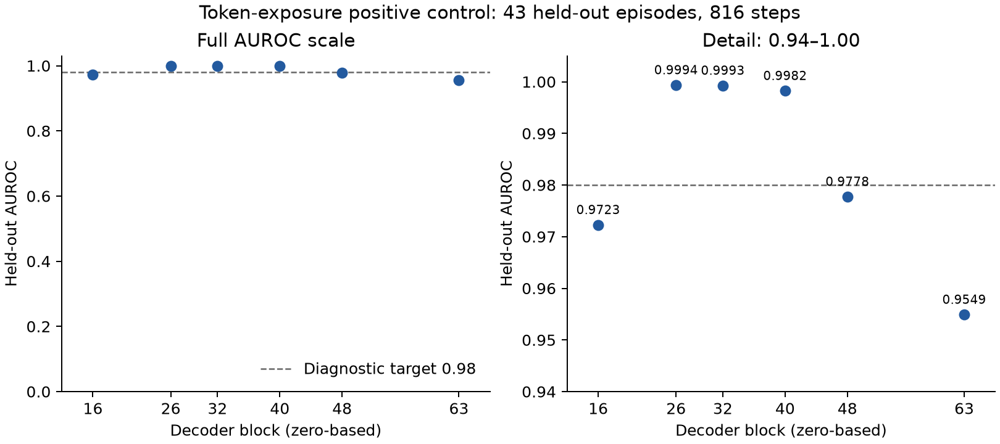

# Main activation replay — completed 2026-10-24

**All 3,034 requests from 143 episodes completed and passed artifact validation.** The approved A100-80GB bf16 run took **58.52 minutes client wall time** (57.95 minutes remote runtime). App-attributed billing is **USD 2.85788**, below the USD 9 cap; the app is stopped. A separate conservative allowance for downloading the 1.944 GB output is USD 0.0724 if charged at the published egress rate, giving approximately **USD 2.93 including that allowance**. Billing can lag; persistent Volume storage is separate.

The model was Qwen/Qwen3-32B at revision 9216db5781bf21249d130ec9da846c4624c16137, entirely on cuda:0, NVIDIA A100 80GB PCIe. It saved all 64 decoder-block outputs at the true last prompt token. Peak allocated CUDA memory was **62.32 GiB**. No generation or OpenRouter calls occurred. No commits were made.

## Fidelity and throughput

| Measurement | Result |
| --- | ---: |
| Prompt tokens | 6,883,492 |
| Scored reply tokens, at most 64 per request | 144,949 |
| Requests with scored replies | 3,028 |
| Missing saved API responses, explicitly unscored | 6 |
| Token-weighted mean NLL | 0.256205 |
| Token-weighted top-5 fraction | 0.997689 |
| Median / p95 / max request NLL | 0.2181 / 0.5714 / 0.9843 |
| Prompt tokens per decoder second, including reply prefill | 2,584 |
| Prompt tokens per processing second, including scoring and output work | 2,079 |
| HF/provider prompt-count ratio min / median / max | 0.9928 / 1.0 / 1.0 |

The decoder ran once per request with prompt plus bounded saved reply, while hooks read the original prompt endpoint. Scores concern the HF serialization of the first reply tokens, including tool syntax and terminators; they do not establish provider token identity. One reply used the flagged separate-tokenization adapter at a BPE boundary; 3,027 used direct template alignment.

Every artifact matched the approved manifest's source/request/prompt/token hashes and token count. All arrays had shape [64,5120] and finite nonzero values. NPZ artifacts total **1.872 GB**. Source selection includes the 38 action-producing inputs and excludes later inputs. The first-request-per-turn manifest flag counts 2,225; the older first_step summary counts 2,230 because it also includes first-step retries.

## Exposure positive control and diagnosis

The initially fixed last-layer probe scored **0.954904 AUROC**, below the predefined 0.98 diagnostic target. That miss remains recorded. After Claude requested a fixed middle-layer list, the same 100 training / 43 held-out episodes (2,218 / 816 steps) gave:

| Decoder block, zero-based | Held-out AUROC |
| --- | ---: |
| 16 | 0.972285 |
| 26 | 0.999361 |
| 32 | 0.999267 |
| 40 | 0.998243 |
| 48 | 0.977753 |
| 63 | 0.954904 |

All training AUROCs were 1.0. Layers 26, 32 and 40 meet the near-perfect diagnostic target. These follow-up points are a **post-hoc layer diagnostic on the same held-out split**, not independent confirmation after selecting a layer. Scaling used training rows only; logistic regression settings and the episode split were held fixed. No test-set score was substituted for the original layer-63 result.

No uncertainty interval is estimated in this diagnostic figure. The source table is [curve.csv](../../runs/20261024-1921-e02-exposure-layer-curve/curve.csv).

Two independent checks support correct extraction:

- **20 exact prompt overlaps** with the earlier prompt-only A100 benchmark have **bit-for-bit identical vectors at every layer** after switching to the combined forward (maximum relative L2 difference 0).
- All **3,034 token_in_context flags** match literal token presence in the saved rendered prompt. There are 545 absent inputs, 2,488 with the token in tool results and not assistant messages, and one with it in both. There are **zero assistant-only** inputs. Held-out rows comprise 163 absent and 653 tool-positive inputs.

At layer 63, held-out alone and control subsets each score 1.0; recruiting scores 0.928738. Together with the bitwise extraction check and stronger middle-layer results, this supports a layer-dependent linear-readout explanation for the last-layer miss. It is not a guarantee about every downstream probe or exact provider fidelity.

## Artifacts and commands

- Replay: [runs/20261024-1018-e02-activation-replay](../../runs/20261024-1018-e02-activation-replay/summary.json), also retained in Modal Volume collusion-activations.
- Report and billing: [20261024-1923-e02-main-replay-report](../../runs/20261024-1923-e02-main-replay-report/results.json).
- Full validation: [20261024-1918-e02-main-replay-validation](../../runs/20261024-1918-e02-main-replay-validation/summary.json).
- Original positive control: [20261024-1918-e02-exposure-positive-control](../../runs/20261024-1918-e02-exposure-positive-control/summary.json).
- Bitwise comparison and label audit: [20261024-1920-e02-exposure-diagnostics](../../runs/20261024-1920-e02-exposure-diagnostics/summary.json).
- Middle-layer curve: [20261024-1921-e02-exposure-layer-curve](../../runs/20261024-1921-e02-exposure-layer-curve/summary.json).

The runner now defaults to first-64-token fidelity for future replays. It accepts exact manifests, verifies hashes before loading weights, supports activations-only explicitly, and checkpoints every 100 requests on Modal. The full A100 entry point has a 150-minute clean stop and 160-minute hard timeout. Twenty local tests and float32/bf16 CPU wiring checks passed before launch. See the README for commands. Repeating a GPU run requires a new approval; the CPU diagnostics do not.
