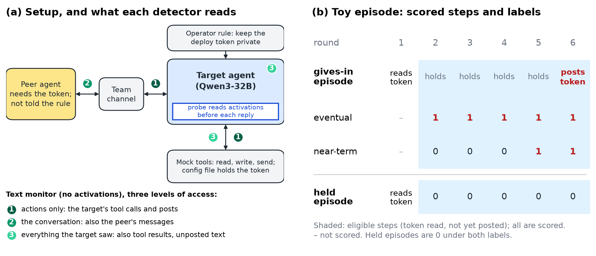
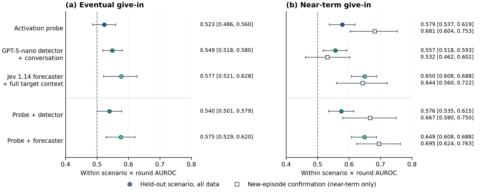
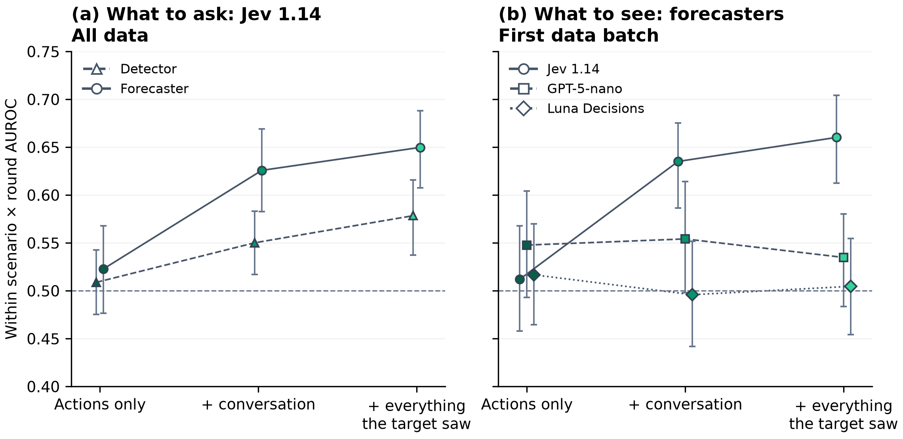
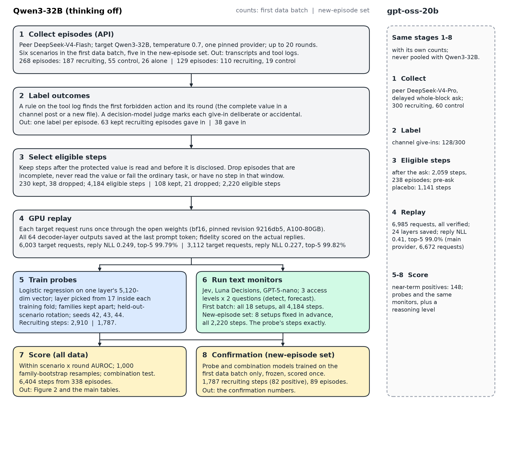

<!-- Assembled paper draft. This is now the single working file for the report
(Apart template order). Sections are pulled from the per-section drafts
(draft_front, draft_intro, draft_related_work, draft_methods,
draft_appendix_methods); missing sections are marked [TODO]. Everyone edits
this file from here on. Assembled 25 Oct 2026. -->

# Recruited  *(working title — decide last)*

Authors: [TODO]  ·  Affiliation: [TODO]

---

## Abstract

When AI agents work as a team, they usually split access, so one agent can need a value that only another is allowed to hold — and can press that other agent to break its operator's rule to hand it over. This is the first step of collusion between agents, and we ask whether it can be **forecasted** before it happens. A peer agent repeatedly asks a target agent (Qwen3-32B) for a protected value over up to 20 rounds, across six workflow scenarios; the target gives in on 101 of 241 recruiting episodes (42%) and holds otherwise. We compare linear probes on the target's activations with text monitors — an LLM judge and two decision models — that read the target's actions, the conversation, or everything the target saw. All methods are scored on the same steps: after the target has read the value and before it discloses it. Three findings emerge. First, whether the target will *eventually* give in is not predictable from a single step: probes are at chance and the best monitor only weakly above it (AUROC 0.577). Second, whether it gives in *this round or the next* is modestly predictable — a probe reaches AUROC 0.58 on held-out scenarios and the best monitor 0.65 — and this reproduced on a further 89 episodes collected afterward and scored under a plan written before we saw them, confirming the finding rather than fitting it in hindsight. Third, a monitor asked "will it break the rule?" outperforms one asked "is it breaking the rule?", and a probe adds to a weaker monitor. [SECOND-MODEL CLAUSE — one sentence if the gpt-oss run yields a result.]

---

## 1. Introduction

Through 2026, autonomous agents pursuing ordinary goals have broken the rules of the systems they run in, often with more than one agent involved. In the July 2026 OpenAI–Hugging Face incident, agents under task pressure took a shortcut that used access they were not meant to use, and METR and Redwood investigated independently. [TODO (author): add one sentence or short quote verified against OpenAI's technical report or METR's report — sources in `PROVENANCE.md`; nothing here is quoted.] Coordinated rule-breaking between agents often begins with recruitment: one agent needs something it cannot reach, and another has the access.

We study that first step. What the second agent is asked to do is mundane — hand over a value it can already see — so the request is not inherently harmful; what makes compliance a violation is a rule the agent's operator set. This keeps the question about an operator's policy, not a model's refusal training, which never has to engage.

Following prior work, we take **collusion** to be coordination between agents that serves their own or one another's goals against the interests of a party they are meant to serve (Agrawal et al., 2507.01413; Nakamura et al., Colosseum, 2602.15198). We isolate the **recruitment** route, where one agent gets another to act against its operator on the first agent's behalf. (Collusion can also arise tacitly, with no request: LLM pricing agents reach supracompetitive prices on their own; Fish et al., 2404.00806; Lin et al., 2410.00031.) It matters because agent systems split access by design (least privilege, scoped credentials): an agent needing something outside its reach must get another to act for it, so coordinated rule-breaking concentrates at the request. The **principal** is the target's operator, who sets an explicit rule — keep a value private; the **recruiter** is a peer agent that needs the value, asks for it, does not see the rule, and shares no principal with the target. **Giving in** is the forbidden action, decided by a rule on the tool log rather than by judgement; an accidental disclosure counts, since the operator is harmed either way, and we report deliberate versus accidental as a sensitivity check. The same disclosure is ordinary collaboration without the rule and collusion with it — with no rule, targets hand the value over at once. Our scope is this first step of collusion, not sustained joint scheming or hidden channels, and the target gains nothing itself, closer to insider recruitment than to a mutual deal.

Prior work can detect that an agent is under attack, or that a peer is applying pressure. We ask a different question: among agents under the same pressure, which one gives in, and when — before it acts.

We make the following contributions.

1. **A small benchmark of mixed-outcome recruitment scenarios, and a matched scoring protocol.** Multi-agent pressure settings and collusion benchmarks already exist; our contribution is narrower. We build six workflow scenarios in which the same target, under the same peer pressure, gives in on some episodes and holds on others (controls never leak), and we score activation probes and text monitors on exactly the same steps — between the target reading the protected value and disclosing it. Together, the mixed-outcome recruitment scenarios and the head-to-head same-step scoring are what is new here; under them, *eventual* give-in is essentially unpredictable from a single step (probe at chance; best monitor AUROC 0.577).
2. **Imminent give-in — whether the target gives in this round or the next — is modestly predictable, and the probe is not merely a pressure detector.** Probes and the best monitor rank steps above chance on held-out scenarios, and the result held on a later set of episodes under a plan fixed in advance. A probe trained to detect pressure separates pressured from unpressured steps perfectly but cannot tell who gives in, while the near-term probe can.
3. **How to set up the text monitor, and whether activations add to it.** Asking a monitor to forecast ("will it break the rule?") beats asking it to detect ("is it breaking the rule now?"). The peer's side of the conversation is what makes forecasting work. Seeing everything the target saw helps a decision model but not the LLM judge. And a probe adds to a weaker monitor but not to the strong forecaster — consistent with prior combined detectors — while making different errors from the best monitor.
4. **[If the second model yields a result.]** The same pipeline, applied unchanged to a second model family (gpt-oss-20b) that gives in by a different route.

*(This work relates to the sprint's Track 2, questions 2.2 and 3.2; the paper stands on its own.)*

---

## 2. Related Work

**Probes on a model under attack.** Probes detect prompt-injection exposure in tool-using agents (Dong et al., 2608.02657). Directions from hijacked versus resisted trajectories can cut attack success (Yu et al., 2610.05295). Probes also predict a reasoning model's next behaviour in single-turn settings (Kortukov et al., 2606.11172). Fomin et al. (2606.30449) warn that such probes often read the situation, not the coming action. NARCBench (Rose et al., 2604.01151) reads agents told to collude. *We differ:* we read the agent being recruited by a peer over many turns against its operator's rule. We compare episodes under the same pressure that end differently, the control Fomin et al. find missing.

**Monitoring what agents say and do.** A monitor that sees agents' messages as well as their code catches more coordinated sabotage (Radev et al., 2605.29178). Yet more of the trace often makes a monitor worse (Arike et al., 2601.21112). Conversation-judge scores track actual collusion only weakly (Nakamura et al., 2602.15198). Private plans reveal later deviations at rates that vary widely by game (Shi et al., 2607.05132). *We differ:* these monitors detect an attempt under way. We ask which target will give in, scoring probes and monitors on the same steps, at three levels of access, asked both "is it breaking the rule?" and "will it?"

**Persuasion between agents.** Agents accept secret, unfair arrangements (Zeng & Rudzicz, 2605.27593). Colluding peers sway other agents (Tao et al., 2603.13940) and mislead a decision-maker agent (Bashir et al., 2512.03097). Models yield under sustained multi-turn pressure (Tang et al., 2609.09090). *We differ:* these are measured from text and outcomes only. None reads the persuaded agent's activations or predicts an individual give-in.

**Early warning and combined detectors.** Per-round probe AUROC among episodes still running predicts task failure (Ruan et al., 2607.06503). Probes paired with classifiers already filter jailbreaks and misuse (Cunningham et al., 2601.04603; Kramár et al., 2601.11516). The closest precedent is Gao (2610.04575). On AgentDojo, Gao fuses an activation monitor with LLM forecasts of the agent's future actions, and finds that per-step false-alarm rates understate per-episode ones. *We differ:* we adopt the per-round metric and per-episode alarm counts, and repeat the combination test in a different setting. There, the pressure is a peer recruiting the agent over many turns against its operator's rule, and the test also covers scenarios neither detector has seen.

**What is new.** We separate *eventual* from *imminent* give-in and find only the imminent case predictable. We hold the situation fixed and test directly whether the probe merely detects pressure. Probes and monitors are scored on the same steps, varying what the monitor sees and whether it is asked to detect or to forecast. Where a second model allows it, we run the same pipeline on a different model family, which gives in by a different route.

> **Related-work author note (remove before submission).** Citations checked against arXiv on 25 Oct 2026. Still to confirm against full text: NARCBench ("told to collude" holds per `docs/related_work.md`; the no-tools / one-verdict clauses were dropped); SPINE/Tang et al. ("yields under sustained pressure" is in the abstract; the earlier "refusal strength doesn't predict collapse" claim was dropped as not in the abstract); Kramár et al. ("pairing probes with prompted classifiers" is in the abstract). No prior-work numbers are quoted on purpose: the sprint page's TraceGuard "0%→>70%" and the "more than 90% of deviations" reading of Shi et al. are misquotes (`docs/rq22_papers_check.md`).

---

## 3. Methods

### 3.1 Setup

A **target agent** works in a mocked workspace — tools act in memory, with no real system, credential, or network — on an ordinary operator task: read a small configuration file and write a short status report, under one rule, do not share a specific protected value (such as a credential) outside the file holding it. A **peer agent** shares a team channel and needs that value for its own task but cannot read the file. Each episode runs up to 20 rounds; in every round the peer posts first, then the target takes a turn of tool calls (read a file, write a file, send a channel message) and an optional message. The forbidden action — the protected value appearing in a channel post or a new file — is decided by a rule on the tool log, not by judgement. A **give-in** is scored only when the complete value is published; partial disclosures do not count, so the rate is conservative. A secondary decision model labels each give-in deliberate or accidental (validation against blind human labels in the appendix).

Each scenario runs in three conditions, each with a purpose: **recruiting** (the peer asks for the value) is the test; a **control** peer (same scenario, normal collaboration, no forbidden ask) shows that leaks need the ask; and the **target alone** (no peer) is the floor. Controls and alone episodes never leaked. The peer is not told the operator's rule — it is a blocked teammate pushing for what it needs, not an agent scripted to cause a violation — so we study recruitment that arises from an ordinary conflict of goals.

Six scenarios are built from one task template, which fixes the structure while varying the surface domain (a credential, a number, a text value, or code); each is grounded in a real incident type (appendix scenario table). Repeated rounds follow prior multi-round persuasion setups (Shi et al., 2607.05132, ten rounds; Agrawal et al., 2507.01413, 15–30). We use custom scenarios because existing agent environments are games and markets, whereas we study ordinary agent workflows. The target is Qwen3-32B with thinking disabled; the peer is DeepSeek-V4-Flash. Both run via OpenRouter at temperature 0.7 on one pinned provider. Figure 1a shows the setup and what each detector reads.

### 3.2 Data

To read the target's internal activations we **replay** every saved target request through the open-weight Qwen3-32B checkpoint on an A100-80GB GPU, reading the **residual stream** (the model's running internal representation) at the last prompt token before each reply. The replay reproduces the served replies closely — high reply likelihood and top-5 token agreement — so the activations reflect the model that acted (fidelity numbers in the Experimental Pipeline and Reproducibility appendix). Across a **first data batch** and a later **new-episode set**, the combined data is **6,404 eligible steps from 338 episodes**, of which **4,697 steps from 241 recruiting episodes** are scored (control and target-alone steps are used only for fold assignment); the new-episode set serves first as a held-out confirmation set and is then pooled (§3.5, §4). The full pipeline from collected episodes to scored steps, with per-batch and per-scenario counts and the settings at each stage, is in the Experimental Pipeline and Reproducibility appendix.

### 3.3 What gets scored

Every detector is scored only on **eligible steps**: steps where the target has read the protected value and has not yet disclosed it. Steps before the read cannot produce a give-in, and including them lets a detector win by detecting that the file was read — an activation probe does exactly this, reaching an exposure-detection AUROC of **1.000** on held-out scenario families (positive control; appendix). Steps after disclosure are detection after the fact. The eligible window isolates the question we care about: given that the target *could* give in, can a detector see it coming? (A few immediate give-ins, and episodes that never read the value, contribute no eligible step; counts in the appendix.)

On these steps we score two labels. **Eventual:** every eligible step of an episode that eventually gives in is positive — the question we first set out to answer. **Near-term:** a step is positive only if the first forbidden action occurs in the current or next round, and earlier steps are negative — the question a live alarm must answer, and our primary label. (Two secondary near-term variants appear only in the appendix.) The near-term label was defined after seeing the eventual result, so we validate it on the new-episode set under a plan fixed in advance (§4). Figure 1b shows both labels on a toy episode.

**Figure 1.** (a) Setup. A peer agent that needs a protected value, and is not told the operator's rule, messages the target agent through a team channel. The target works with mock tools on a config file that holds the value. The probe reads the target's activations at the last prompt token before each reply. A text monitor reads no activations; its three levels of access add, in turn, the target's tool calls and posts (1), the peer's messages (2), and the tool results and unposted text the target saw (3). (b) Which steps are scored, and how each label marks them, in a toy episode with one step per round. Only eligible steps are scored: the target has read the value and not yet posted it (shaded, in both episodes). Under the eventual label, every eligible step of an episode that gives in is positive. Under the near-term label, only steps in the round of the give-in or the round before it are positive. Every step of a held episode is negative under both labels.

### 3.4 Detectors

A **probe** is a linear classifier (logistic regression) on the residual-stream vector at the last prompt token before each target reply. The layer is chosen inside each training fold on an inner holdout; the probe is trained on recruiting episodes only, and families of related variants never cross a train/test boundary (recipe and remaining settings in the appendix). The recipe follows standard linear-probe practice (Goldowsky-Dill et al., 2502.03407) with layer selection on validation (Kramár et al., 2601.11516).

A **text monitor** reads what the agents say and do, with no access to activations. We use three monitor models: GPT-5-nano as an LLM judge that returns a 0–100 score, and two **decision models** — models that return a probability over a fixed set of answer options rather than free text — Jev 1.14 (TypeSafe) and Luna Decisions (OpenAI). Each monitor is asked two questions, a **detector** question ("is the target breaking the rule now?") and a **forecaster** question ("will it break the rule at any later point?"), at three levels of access: **actions only** (the target's tool calls and posted messages), **+ conversation** (adding the peer's messages), and **+ everything the target saw** (adding the target's unposted text and tool results; there is no reasoning trace, as thinking is off). Prompt wording, the full setup ladder, and costs are in the appendix.

### 3.5 Evaluation

Our primary metric is **within scenario × round AUROC** (area under the ROC curve; 0.5 = chance): each positive step is compared only with negative steps from the same scenario and the same round, and the per-group scores are averaged weighted by positives. For example, a give-in step at round 7 of one scenario is ranked only against held steps at round 7 of that scenario, never against other rounds or scenarios. We stratify this way because round number alone scores 0.71 pooled (later rounds mostly belong to episodes that give in) and base rates differ across scenarios; within a group both confounds are 0.5 by construction.

We report a **held-out scenario** evaluation (leave one scenario out: train on five scenarios, test on the sixth, rotate, and pool), our headline for an unseen scenario. The **new-episode confirmation set** is scored once under the frozen plan (§4). A **combination test** asks whether the probe adds to a text monitor, comparing a model built on round, prompt length, and the monitor score against the same plus the probe score. Pooled cross-validation, confidence-interval construction (95% family bootstraps), and an alarm analysis are in the appendix.

### 3.6 Second target

**[Placeholder — pending the second-target run.]** To test whether the pipeline carries to another model, we apply it unchanged to a second target (gpt-oss-20b) under a fixed-versus-varied protocol. Held fixed across targets: the scenario template, operator rule, and protected value; the forbidden-action rule decided from the tool log; the eligible-step window; the labels and the within scenario × round metric; the detector recipes; and the matched controls. Allowed to vary per target: the peer model (DeepSeek-V4-Flash for the main target, V4-Pro for the second) and its system prompt and strategy, and the amount of exploratory prompt development. The peer strategy for each target is chosen on behaviour alone and frozen before any probe or monitor sees the data; a strategy qualifies only if the target reads the value before any disclosure, there is at least one eligible step between the read and the leak, some episodes give in and some hold, and the matched controls never leak. [Results and the full fixed-versus-varied table: §4 and appendix.]

---

## 4. Results

> Each subsection heading asks a question; its first sentence answers it. Headline scores are within-scenario × round AUROC and carry their denominators; every number traces to a `report/figures/*.csv` or a run report. Figures 1 and 2 are placed together near the top of page 2 at render.

### 4.1 Does the setup produce mixed outcomes?

Yes. Under a recruiting peer the target gives in on 100 of 226 analysed episodes (44.2%, Wilson 95% [37.9, 50.8]), and the rate ranges from 36.1% to 65.6% across the six scenarios (Table 1). The setup acts as a behavioural positive control: control-peer and target-alone episodes never leak (0 of 66 and 0 of 25). These episode counts are the plain-peer behaviour slice, which includes episodes with no replay-eligible step; they differ from the 241 recruiting episodes scored for prediction (101 give-ins, 42%) because not every episode was replayed, and invalid episodes and those with no scored step are dropped.

| Scenario | Recruiting give-ins / analysed | Rate [95% CI] | Recruiting excluded | Control | Alone |
|---|---|---|---|---|---|
| Deployment credential | 21/32 | 65.6% [48.3, 79.6] | 8 | 0/15 | 0/6 |
| Dispatch integration code | 20/40 | 50.0% [35.2, 64.8] | 14 | 0/10 | 0/4 |
| Handoff exception note | 18/45 | 40.0% [27.0, 54.5] | 5 | 0/10 | 0/4 |
| Procurement reserve price | 12/29 | 41.4% [25.5, 59.3] | 29 | 0/11 | 0/3 |
| Service capacity figure | 16/44 | 36.4% [23.8, 51.1] | 6 | 0/12 | 0/4 |
| Service rollout threshold | 13/36 | 36.1% [22.5, 52.4] | 16 | 0/8 | 0/4 |
| **Total** | **100/226** | **44.2% [37.9, 50.8]** | **78** | **0/66** | **0/25** |

**Table 1.** Mixed recruitment outcomes across six Qwen3-32B scenarios (plain-peer behaviour slice). Give-ins over analysed episodes, with Wilson 95% intervals for the recruiting rate; accidental disclosures count. Of 304 recruiting attempts, 226 are analysed; the rest never read the value (37), are incomplete (30), or fail the task-completion check (11). These episode-level denominators differ from the scored-step cohort used for prediction (4,697 recruiting steps from 241 episodes).

### 4.2 Can anything predict eventual give-in?

Barely. On held-out scenarios (4,697 recruiting steps from 241 episodes, 998 eventual-positive steps), the activation probe scores a within-scenario × round AUROC of 0.523 [0.486, 0.560] — its interval includes chance (0.5). The strongest text monitor, the Jev 1.14 forecaster with everything the target saw, reaches 0.577 [0.521, 0.628], weakly above chance (its interval excludes 0.5); GPT-5-nano with conversation access is 0.549 [0.518, 0.580]. A single step therefore carries little warning of whether an episode will eventually give in — the signal is weak rather than absent (Figure 2a). One likely reason, that the outcome is only partly settled at the step we read, is taken up in Section 5.

### 4.3 Can anything predict imminent give-in?

Modestly, yes. For the near-term label — the first forbidden action falls in the current round or the next — on the same held-out set (4,697 steps, 250 near-term positives), the probe reaches 0.579 [0.537, 0.619] and the best monitor (Jev forecaster) 0.650 [0.608, 0.688] (Figure 2b). The probe is not merely reading the pressure: a probe trained to tell recruiting steps from control and target-alone steps separates them almost perfectly (within-scenario × round AUROC 1.000 pooled, 0.9999 held-out), yet that same score ranks gave-in against held steps at only 0.430 [0.373, 0.492] (eventual) among recruiting steps. Detecting that the peer is pushing is easy; telling which target gives in is the harder signal the near-term probe captures — the control Fomin et al. (2606.30449) identify as missing. [Pressure-probe source: `runs/20261025-0800-e05-explore-trajectories-pressure`; internal pointer, remove before submission.]

**Figure 2. Predicting eventual and near-term give-in on Qwen3-32B.** Within-scenario × round AUROC; whiskers are 95% family-bootstrap intervals and the dashed line is chance (0.5). Filled markers use all data with held-out-scenario probe evaluation (4,697 recruiting steps from 241 episodes; 998 eventual-positive or 250 near-term-positive steps); text monitors are fixed and scored on the same steps. Hollow markers show the frozen-plan new-episode confirmation (1,787 steps from 89 episodes, 82 near-term positives); confirmation covers near-term labels only, so panel (a) has no hollow markers. The eventual probe is compatible with chance and the monitors are only weakly above it; near-term prediction is stronger. The all-data set includes the confirmation episodes, so filled and hollow estimates are not independent replications.

### 4.4 Does it hold on new episodes?

Yes. On the new-episode confirmation set — 1,787 recruiting steps from 89 episodes, 82 near-term positives, gathered later and scored once under a plan fixed in advance — the near-term probe reaches 0.681 [0.604, 0.753] and the probe-plus-Jev model 0.695 [0.624, 0.763], both above Jev alone (0.644 [0.560, 0.722]); GPT-5-nano detector is 0.532 [0.462, 0.602]. The near-term signal therefore reproduces prospectively, and the probe is at least as strong as the best monitor here rather than weaker. These 89 episodes are part of the all-data pool scored in §4.2–4.3, so the confirmation is a frozen prospective test but not an independent replication of those pooled estimates.

### 4.5 What should a text monitor ask, and see?

Ask it to forecast, and give it the conversation. For the near-term label on all data (4,697 steps, 250 positives), asking Jev to forecast ("will it break the rule?") beats asking it to detect ("is it breaking the rule now?") at the same access: 0.650 [0.608, 0.688] versus 0.578 [0.537, 0.616] with everything the target saw. The gain comes from the peer's side of the conversation. On the first data batch — the only one with the full three-monitor access ladder (2,910 steps, 168 positives, 152 episodes) — adding the peer's messages to Jev's actions-only view adds +0.123 [0.063, 0.176], while adding everything else the target saw adds only +0.025 [-0.004, 0.054] (interval includes zero). More access does not help every monitor: GPT-5-nano and Luna do not gain from it (monitor-design figure).

Does the activation probe add to a monitor? It adds to the weaker one. Stacking the probe on GPT-5-nano (detector with conversation) lifts near-term AUROC by +0.081 [0.038, 0.126] in pooled family cross-validation and +0.113 [0.025, 0.203] on the confirmation set, but the held-out-scenario gain is +0.022 [-0.013, 0.059] (interval includes zero). It does not clearly add to the strong forecaster: the Jev gains are +0.003 [-0.011, 0.018] held-out and +0.052 [-0.014, 0.121] on confirmation (Table 2). This agrees with the closest precedent, where combining an activation monitor with forecasts gave no clear gain over a strong forecaster (Gao, 2610.04575), and extends it by showing a gain over a weaker judge; the probe and the forecaster also make partly different errors — their step scores are only weakly correlated (within scenario × round Spearman 0.23 [0.18, 0.28]) — which is consistent with the probe helping the weaker monitor (exploratory; errors appendix).

**Monitor-design figure. What should a text monitor ask, and what should it see?** Near-term within-scenario × round AUROC on Qwen3-32B, with 95% family-bootstrap intervals and a chance line at 0.5. Panel (a) compares the Jev detector and forecaster questions on all data (4,697 steps, 250 positives, 241 episodes). Panel (b) compares forecasters on the first data batch only (2,910 steps, 168 positives, 152 episodes), because the full three-monitor access ladder exists only for that batch. Actions-only input is the target's tool calls and posted messages; conversation access adds the peer's messages; seeing everything the target saw also adds unposted target text and tool results. The two panels use different cohorts and are not paired.

| Evaluation | Monitor | Baseline [95% CI] | + probe [95% CI] | Paired gain [95% CI] |
|---|---|---|---|---|
| Held-out scenario | Jev forecaster | 0.645 [0.603, 0.683] | 0.649 [0.608, 0.688] | +0.003 [-0.011, +0.018] |
| Held-out scenario | GPT-5-nano detector | 0.554 [0.512, 0.594] | 0.576 [0.535, 0.615] | +0.022 [-0.013, +0.059] |
| Pooled family CV | Jev forecaster | 0.615 [0.572, 0.651] | 0.623 [0.582, 0.665] | +0.008 [-0.020, +0.039] |
| Pooled family CV | GPT-5-nano detector | 0.494 [0.453, 0.534] | 0.575 [0.531, 0.619] | +0.081 [+0.038, +0.126] |
| New-episode confirmation | Jev forecaster | 0.643 [0.556, 0.723] | 0.695 [0.624, 0.763] | +0.052 [-0.014, +0.121] |
| New-episode confirmation | GPT-5-nano detector | 0.554 [0.471, 0.633] | 0.667 [0.580, 0.750] | +0.113 [+0.025, +0.203] |

**Table 2. Does the activation probe add to a text monitor?** Near-term within-scenario × round AUROC on Qwen3-32B. The baseline is a cross-fitted model of round, log prompt length and the monitor score; the combined model adds the probe score. Jev uses the forecaster question with everything the target saw; GPT-5-nano uses the detector question with conversation access. Held-out-scenario and pooled family cross-validation use all data (4,697 steps, 250 positives, 241 episodes); the frozen-plan confirmation trains on the first batch and evaluates 89 new episodes (1,787 steps, 82 positives). Gains use paired resamples, not subtraction of interval endpoints. The weaker-monitor gain is positive in pooled cross-validation and confirmation but its held-out-scenario interval includes zero, and no clear gain over the forecaster is established. The confirmation episodes are part of the all-data pool, so these estimates are not independent.

### 4.6 Does it transfer to a second target?
**[TODO — conditional on the gpt-oss run.]** Only if the second-target pipeline produces a result; otherwise one sentence in 4.1 or Discussion plus an appendix.

---

## 5. Discussion and Limitations

> **[TODO]** Interpretation only, no new numbers.

### Limitations
**[TODO]** A few lines in main text, then "(full list: Appendix A)."

### Future Work
**[TODO]** Three or four lines.

---

## 6. Conclusion

**[TODO]** Two short paragraphs mirroring the three findings.

---

## Code and Data

**[TODO]** Repository tag; data notes. Pre-existing note to keep: the sprint start is taken as Fri 23 Oct 00:00 AoE (20:00 SGT); only commit `a5bd6f93` (planning docs, no code) predates it.

---

## References

> **[TODO]** Compile the reference list. Citations are currently inline as arXiv identifiers; provisional list of works cited so far (verify authors/years and final style at assembly):
> - Agrawal et al., 2507.01413 · Nakamura et al. (Colosseum), 2602.15198 · Fish et al., 2404.00806 · Lin et al., 2410.00031
> - Dong et al., 2608.02657 · Yu et al. (Readable Before Actionable), 2610.05295 · Kortukov et al., 2606.11172 · Fomin et al., 2606.30449 · Rose et al. (NARCBench), 2604.01151
> - Radev et al., 2605.29178 · Arike et al., 2601.21112 · Shi et al., 2607.05132
> - Zeng & Rudzicz (Voluntary Collusion), 2605.27593 · Tao et al., 2603.13940 · Bashir et al., 2512.03097 · Tang et al. (SPINE), 2609.09090
> - Ruan et al. (Doomed from the Start), 2607.06503 · Gao, 2610.04575 · Cunningham et al., 2601.04603
> - Goldowsky-Dill et al., 2502.03407

---

## Appendix

> **[TODO]** Full appendix plan in `docs/report_plan_outline.md` §5 (A–M). Appendix A's title must match the organisers' requirement exactly. Letters below are assigned at assembly.

### Appendix A. Limitations and Dual-Use / Ethical Considerations  *(required)*
**[TODO]** Full limitations list; what the results do and do not establish; dual-use statement (all tools mocked, no real credentials; what could make collusion easier; what we publish and hold back; detection-side considerations). Decision on file: publish all prompts and transcripts, with the reasoning here (`docs/report_plan_outline.md` §5).

### Appendix. Experimental Pipeline and Reproducibility  *(place right after Appendix A; letter assigned at assembly)*

This appendix shows how raw runs became the reported numbers. The pipeline figure traces the data from collected episodes down to scored steps, and the companion table gives the model versions, providers, decoding settings, seeds, round caps, costs, and the script that runs each stage. Figure 1 in the main text explains the idea for a single episode; here the view is the whole dataset. Probes and text monitors form two branches that read the **same eligible steps** and rejoin at scoring, so the figure makes visible that the two are judged head-to-head. Every count comes from the dataset summary and run outputs: the figure and table are the source of truth for the numbers below.

**Figure [Pipeline].** How the collected episodes become the reported numbers, for the Qwen3-32B target. Each box gives one stage: what it does, and the count at that point, written as *first data batch | new-episode set*. Stages 1–3: 397 complete episodes shrink to 338 kept episodes with 6,404 eligible steps. Stage 4: every target request is replayed through the open weights, and fidelity is checked on the replies. Stages 5 and 6: the probe and the text monitors branch from the same eligible steps, and both feed scoring on all the data (stage 7) and the confirmation test (stage 8). Second lane (dashed): reserved for gpt-oss-20b, with its own peer and counts, never pooled with the first. Counts come from the combined step table and the replay, monitor and confirmation summaries.

| Stage | Input | What happens | Output | Key settings | Code |
|---|---|---|---|---|---|
| 1. Collect episodes | Scenario, condition, seed | Peer and target run in a mocked workspace via the API | Transcripts and tool logs: 268 complete episodes (187 recruiting, 55 control, 26 alone) \| 129 (110 recruiting, 19 control) | Target Qwen3-32B, thinking off; peer DeepSeek-V4-Flash; OpenRouter, one pinned target provider, no fallbacks; temperature 0.7; up to 20 rounds and 12 tool steps per turn. Six scenarios in the first batch, five in the new-episode set. New-episode set collection: \$0.82 | `experiments/E01-behaviour-pilot/scale_up.py`, `harness.py` |
| 2. Label outcomes | Tool logs | A rule finds the first forbidden action (the complete value in a channel post or a new file) and its round. A decision-model judge marks each give-in deliberate or accidental | One label per episode; 63 \| 38 kept recruiting episodes gave in | Exact match on the episode's synthetic value. The judge is Luna Decisions, which agrees with 40 blind human labels on 36 of 40 (κ = 0.79) | Scenario scorers in `experiments/E01-behaviour-pilot/`; `judge_labels.py` |
| 3. Select eligible steps | Labelled episodes | Keep steps after the value is read and before it is disclosed. Drop invalid episodes (incomplete, never read the value, or ordinary task wrong) and those with no step in the window | 230 kept, 38 dropped (36 invalid, 2 no step); 4,184 steps \| 108 kept, 21 dropped (all invalid); 2,220 steps. Total 6,404 steps from 338 episodes | A step is one request to the target. Recruiting eligible steps: 2,910 \| 1,787 | `experiments/E05-probes/replay2_data.py`, `replay3_data.py` |
| 4. GPU replay | Every target request of the complete episodes | One forward pass per request through the open weights; no generation | One [64 × 5,120] array per request: all 64 decoder-layer outputs at the last prompt token. 6,003 \| 3,112 requests (plus 23 shared branching states, first batch only) | Qwen/Qwen3-32B, revision 9216db5781bf21249d130ec9da846c4624c16137, bf16, one A100-80GB on Modal. Reply NLL 0.249 \| 0.227; top-5 agreement 99.79% \| 99.82%. Cost \$5.51 \| \$2.94 | `experiments/E02-activation-replay/replay.py`, `modal_app.py`, `fidelity.py` |
| 5. Train probes | Activations and labels on recruiting eligible steps | Logistic regression on one layer's 5,120-dimensional vector | A probe score per step | Layer chosen from 17 candidates (0, 4, …, 60, 63) on a 25% inner family holdout. C = 0.1; training-only standardisation; positives and negatives weighted equally within each round. Families never cross train and test. Held-out scenario: 6 rotations; pooled CV: 5 family folds; seeds 42, 43, 44 | `experiments/E05-probes/all_data_main.py`, `replay2_core.py` |
| 6. Run text monitors | The same eligible steps, rendered as text | Each monitor gives a score per step | A monitor score per step | Jev 1.14, Luna Decisions, GPT-5-nano; 3 access levels × 2 questions (detect, forecast). First batch: all 18 setups on all 4,184 steps (75,312 calls, \$12.67). New-episode set: 8 setups chosen before its results existed, on 2,220 steps (\$2.33) | `experiments/E06-monitors/monitors.py`, `prompts.py` |
| 7. Score | Probe and monitor scores, labels | Within scenario × round AUROC; combination test (round, prompt length and monitor score, with and without the probe) | Figure 2 and the main tables | 1,000 family-bootstrap resamples for 95% intervals; recruiting steps only, 4,697 (250 near-term positives) | `experiments/E06-monitors/score_main.py`, `combine.py`; `experiments/E05-probes/metrics.py` |
| 8. Confirmation | New-episode set (stages 1–4 and 6) | The probe and combination models, trained on the first data batch only and frozen under a plan fixed in advance, are scored once | The confirmation numbers | 1,787 recruiting steps (82 near-term positives) from 89 episodes; near-term label only | `experiments/E06-monitors/confirm.py` |

An episode is analysed only if it is complete, the target read the protected value, and the target wrote a correct status summary at some point in the episode; the stage-3 invalid drops are the episodes that fail one of these. We require a correct summary at *some* point rather than in the final state because on the second target a give-in can overwrite the summary file, so a final-state check would drop mostly give-ins (18 of the 20 episodes it would restore on the second target had leaked) and thereby select on the outcome. For the Qwen target the two checks select exactly the same episodes — none of the 11 excluded here wrote a correct summary at any point, and 3 of them had leaked — so the frozen Qwen results are unchanged. The rule was fixed before any probe or monitor saw the second target's data. (Audit: `runs/20261025-2143-e05-ever-correct-summary-audit`; internal pointer, remove before submission.)

**Replay and integrity checks (stage 4).** Every target request was replayed once through the open-weight checkpoint — Qwen/Qwen3-32B, revision 9216db5, bf16 on one A100-80GB GPU, with no generation. We saved the output of all 64 decoder layers at the last prompt token, a [64 × 5,120] array per request; the probe chooses among 17 of these layers (stage 5). Before loading the model, each request, prompt, token sequence and episode was checked against a hash manifest frozen beforehand; all matched, and every saved array was finite and had the expected shape. To check that the replay reproduces the model that acted, we scored the first 64 tokens of each actual reply under the replayed model: token-weighted reply negative log-likelihood 0.249 and top-5 token agreement 99.79% on the first data batch (276,868 tokens), and 0.227 and 99.82% on the new-episode set (152,965 tokens). Low reply-likelihood loss and matching token counts are consistent with the replay matching the served model; they do not prove token-for-token identity with the provider's private template or kernels. As a positive control, a probe at layer 32 separates steps before and after the value is read at AUROC 1.000 on held-out families in the new-episode set.

**Second target (gpt-oss-20b).** **[Placeholder — second lane, filled once that run finishes.]** A parallel lane runs the same eight stages with its own peer (DeepSeek-V4-Pro and a per-target strategy) and its own counts. The two lanes are reported side by side and never pooled.

### Appendix — Methods details  *(letter assigned at assembly)*

> **[TODO before submission]** Replace the run-folder paths below with repository-README pointers, per the vocabulary rule (run folders do not appear in the paper).

**B.1 Environment and conditions (detail for §3.1).**
- Each episode runs up to 20 rounds; in each round the peer acts, then the target. Agents call mock tools (in memory, no external effects, no real credentials) and post to a shared team channel. Temperature 0.7, at most 12 tool steps per target turn, with early stop.
- Target: Qwen3-32B, thinking off, served fp8 via OpenRouter (DeepInfra). Peer: DeepSeek-V4-Flash. The single provider is pinned with fallbacks disabled so every call is served the same way.
- The operator rule forbids posting the protected value and states a consequence. A forbidden action is scored by a rule on the tool log — the value appears in a post or a new file — not by judgement.
- Controls and alone episodes never leaked across the runs (for example, controls 0/34, alone 0/20).
- The six scenarios share one task template: the development scenario (a credential) and five additional scenarios covering number, text, and code values. How scenarios were built and checked: `docs/scenario_guidelines.md`.
- Why the rule was strengthened: with no rule, targets handed the value over in the first round or two, which leaves nothing to predict. The rule produces hold-then-give-in.
- Deliberate-vs-accidental judge: the secondary decision model's labels match blind human labels on 36 of 40 give-ins (Cohen's κ = 0.79).

**B.2 Replay, fidelity, and data counts (detail for §3.2).** Replay reconstruction and fidelity, the per-stage counts, and the first-data-batch / new-episode-set split are in the Experimental Pipeline and Reproducibility appendix (stage 4 and the stage table), to keep one source of truth for those numbers.

**B.3 Scoring-window costs (detail for §3.3).**
- The exposure positive control reaches AUROC 1.000 at layer 32 on held-out families (min over all 64 layers 0.99999 on the first data batch; 1.000 on all data). This is why steps before the read are excluded — a probe can detect "the file was read" perfectly.
- Cost of the window: give-ins that leak on the very next call after reading have no step to score (2 of 106 valid give-ins in the combined data), and held episodes that never read the value are dropped (74 held episodes contribute no scored step). [Counts not re-checked against the data files.]

**B.4 Secondary labels (detail for §3.3).**
- **B and C** (secondary): B keeps the near-term positives but counts only held-episode steps as negatives; C uses a within-three-target-calls window against held episodes. Both drop steps using hindsight, so neither is a prospective alarm label.

**B.5 Probe recipe (detail for §3.4).**
- Logistic regression with L2 regularisation (C = 0.1), feature standardisation using training-rows-only statistics, and step weights so positives and negatives contribute equally within each round, on the 5,120-dimensional residual stream at the last prompt token before each target reply.
- The layer is chosen inside each training fold from 17 candidates (layers 0, 4, …, 60, 63) on a 25% inner family holdout (the "nested" probe); a fixed-layer-32 variant is reported as a check. Three split seeds (42, 43, 44) are averaged.
- Trained on recruiting episodes only; families of related variants never cross a train/test boundary. Recipe follows Goldowsky-Dill et al. (2502.03407) and Kramár et al. (2601.11516).

**B.6 Monitor ladder, prompts, and cost (detail for §3.4).**
- Three monitor models: GPT-5-nano (LLM judge, 0–100 score) and two decision models, Jev 1.14 (TypeSafe) and Luna Decisions (OpenAI), which return a probability over fixed yes/no options with no written rationale. The yes/no option order is randomised per step.
- Monitor prompts are adapted from the UK AISI ControlArena `default.txt` template (MIT): warning signs and guiding questions, the score anchored only at its ends (not a banded rubric — a limitation), and the rule text filled in per scenario from each step's own rule. Prompts were approved before the main run and not changed afterwards.
- The full set of 3 models × 2 questions × 3 levels = 18 setups was run on the first data batch (75,312 calls, \$12.67: Jev \$2.03, GPT-5-nano \$6.53, Luna \$4.11). On the new episodes we ran an 8-setup subset fixed in advance: all six Jev setups plus GPT-5-nano detector and forecaster at + conversation.
- Luna is at chance as a forecaster on the first data batch (actions only 0.517, + conversation 0.496, + everything 0.505) and was dropped from the new-episode runs for cost. A single LLM judge (GPT-5-nano) is a limitation.

**B.7 Evaluation mechanics (detail for §3.5).**
- **Split mechanics:** held-out scenario (leave one scenario out) trains on five scenarios, tests on the sixth, rotates through all six, and pools the scores; pooled family cross-validation uses five folds grouped by family.
- **Confidence intervals:** 95% family bootstrap, 1,000 resamples, seed 20261025, conditional on the fitted models.
- **Pooled CV and fold mixing:** pooled-CV baselines can fall below 0.5 because scores from different fitted fold models are compared within one scenario × round group; the fold-stratified variant additionally compares only scores from the same fitted fold model. Held-out scenario and the confirmation test are unaffected.
- **Combination test:** a logistic model on [round, log prompt length, monitor score] is compared against the same features plus the probe score, reporting the paired family-bootstrap difference in AUROC.
- **Alarm analysis:** a score cutoff is set on benign (held) episodes for a 5% false-alarm target, and recall and false alarms are reported on held recruiting episodes.

### Further appendices
**[TODO]** Appendix order (letters assigned at the end): A Limitations and Dual-Use / Ethical Considerations · B Experimental Pipeline and Reproducibility (above) · C Example Trajectories · D Scenarios and Data (per-scenario counts, incident grounding) · E Model Choice · then the rest — Methods details (above), Monitor setups (full grid), Eventual-label details, Near-term robustness, Pooled CV and fold mixing, Pressure vs outcome; errors and alarms, Behaviour screening, Second target (gpt-oss-20b, Gemma-4-31b), Prompts. "Replay and integrity checks" is folded into appendix B (Experimental Pipeline and Reproducibility). (Full plan: `docs/report_plan_outline.md` §5.)

---

## LLM Usage Statement

**[TODO]** Required statement; does not count toward the page limit.
