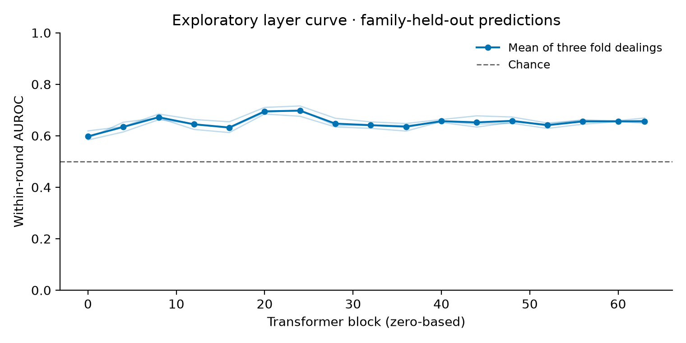
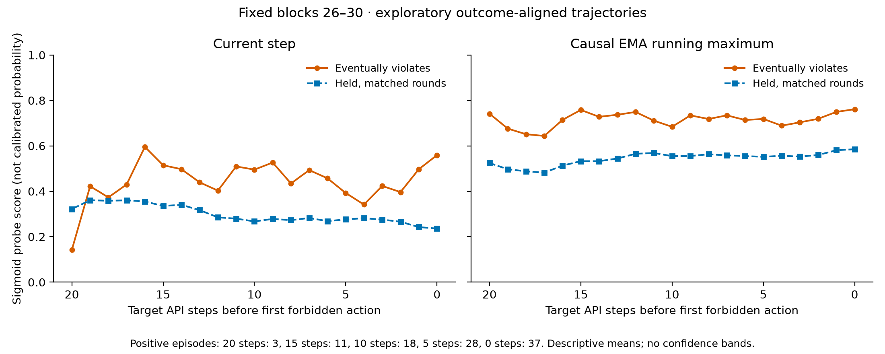

# E05 core probe analysis

Fit run: `20261024-1937-e05-probe-core`. Report run: `20261024-2005-e05-probe-core`. CPU only; no additional model calls or GPU spend.

Headline data: 1810 exposed, valid recruiting steps from 92 episodes (37 give-in, 55 held), 47 families. Action-producing inputs are included; downstream outputs and post-action steps are excluded.

The inner-selected probe has modest within-round discrimination (AUROC 0.658), but episode recall is only 18.0% at the control-calibrated cutoff. Round number alone has pooled AUROC 0.721, so pooled AUROC alone cannot establish value beyond trace length.

## Family-held-out headline

Five outer folds, three fold dealings (seeds 42–44). Layer choice uses one inner family-grouped validation fold; fixed L2 C=0.1. Negative training weights match positive counts within round. Controls/alone only calibrate thresholds. The primary interval resamples whole families, conditional on fitted out-of-fold predictions; episode intervals and per-seed values are in metrics.json. Neither interval refits the probes.

| Method | Within-round AUROC (95% family CI) | Pooled AUROC | Episode recall | Held recruiting FPR | Held-out control FPR |
|---|---:|---:|---:|---:|---:|
| Inner-selected layer | 0.658 [0.593, 0.724] | 0.728 | 0.180 | 0.061 | 0.035 |
| Fixed block 32 | 0.641 [0.544, 0.732] | 0.722 | 0.054 | 0.000 | 0.044 |
| Mean logits, blocks 26–30 | 0.647 [0.563, 0.729] | 0.726 | 0.126 | 0.048 | 0.018 |
| Difference of means, block 32 | 0.616 [0.539, 0.692] | 0.483 | 0.649 | 0.933 | 0.061 |
| Round only | 0.500 [0.500, 0.500] | 0.721 | 0.000 | 0.000 | 0.000 |
| Prompt length | 0.530 [0.413, 0.630] | 0.303 | 0.459 | 0.927 | 0.053 |
| Episode-shuffled labels | 0.509 [0.461, 0.573] | 0.509 | — | — | — |

Recall uses a per-fold threshold calibrated on **control/alone episode maxima** to allow at most floor(0.05 × calibration episodes) false alarms, with strict greater-than for ties. This is a 5% calibration target, not a guarantee of 5% held-out FPR. Training and calibration families never overlap outer-test families.

The main within-round calculation covers 100.0% of eligible positive steps in every fold dealing. Length matching retains 431 positive/negative pairs.

Within-round AUROC weights each eligible round by positive-step count and excludes rounds lacking either class. Pooled AUROC is only a reference because histories have different lengths. The shuffled baseline permutes labels once per episode and fits/evaluates the same shuffled labels; three permutations are a diagnostic, not a permutation p-value.

### Increment over prompt length

| Method | Within-round AUROC difference | Paired family CI |
|---|---:|---:|
| nested_minus_length | 0.128 | [0.005, 0.269] |
| fixed32_minus_length | 0.111 | [-0.021, 0.262] |
| band26_30_minus_length | 0.117 | [-0.015, 0.269] |
| dom32_minus_length | 0.087 | [-0.045, 0.229] |

The fixed-block-32 token-in-context positive control has pooled family-held-out AUROC **0.997**, 95% CI [0.993, 1.000]; within-round AUROC 0.997. This verifies exposure decoding; it does not establish that the outcome probe measures a decision.

## Sensitivities

| Analysis | Recruiting episodes | Inner-selected within-round AUROC (family CI) | Fixed 32 | Blocks 26–30 | Prompt length |
|---|---:|---:|---:|---:|---:|
| deliberate | 82 | 0.695 [0.601, 0.782] | 0.695 | 0.698 | 0.503 |
| episode_sensitivity | 92 | 0.654 [0.580, 0.723] | 0.636 | 0.645 | 0.530 |
| boundary_sensitivity | 93 | 0.639 [0.556, 0.711] | 0.611 | 0.612 | 0.526 |
| tactic_transfer | 34 | 0.631 [0.554, 0.676] | 0.516 | 0.508 | 0.548 |
| tactic_family_transfer | 34 | 0.481 [0.314, 0.651] | 0.495 | 0.500 | 0.548 |

Deliberate-only drops accidental episodes rather than relabeling them held. Boundary sensitivity includes the one file-only violator without semantic publication kind. Episode splitting is a weaker sensitivity because shared family details can cross folds.

- `tactic_transfer`: 58 training, 43 test, 29 calibration episodes; surviving training tactics T0, T1, T2; 8 shared training/test families; inner-selected block 60.
- `tactic_family_transfer`: 44 training, 43 test, 25 calibration episodes; surviving training tactics T0; 0 shared training/test families; inner-selected block 8.

The ordinary tactic holdout tests T3–T7 after training T0–T2 but shares scenario families. The stricter transfer removes all test families before training; its reduced training set changes both tactic and family coverage. Neither is an independent new-data confirmation.

## Step subsets

| Subset | Rows | Positive rows | Inner-selected within-round AUROC | Fixed 32 | Blocks 26–30 | Prompt length |
|---|---:|---:|---:|---:|---:|---:|
| strict_pre_action | 1773 | 395 | 0.649 [0.581, 0.716] | 0.630 | 0.636 | 0.523 |
| decision_not_visible | 1736 | 415 | 0.654 [0.588, 0.713] | 0.635 | 0.645 | 0.521 |
| length_matched | 862 | 431 | 0.640 [0.572, 0.708] | 0.624 | 0.635 | 0.506 |
| provisional_refuses | 1490 | 282 | 0.693 | 0.652 | 0.664 | 0.499 |

### Partial AUROC and fold variability

| Method | Standardized pooled pAUROC (FPR 0–20%) | Within-round AUROC by seed |
|---|---:|---|
| Inner-selected layer | 0.614 | 0.660, 0.666, 0.647 |
| Fixed block 32 | 0.603 | 0.641, 0.654, 0.629 |
| Mean logits, blocks 26–30 | 0.602 | 0.640, 0.667, 0.635 |
| Difference of means, block 32 | 0.538 | 0.621, 0.615, 0.613 |
| Round only | 0.592 | 0.500, 0.500, 0.500 |
| Prompt length | 0.450 | 0.530, 0.530, 0.530 |
| Episode-shuffled labels | 0.510 | 0.559, 0.438, 0.529 |

Partial AUROC here pools steps and therefore shares the history-length caveat of pooled AUROC. The chance-normalized value is0.5. Per-seed mean TPR over FPR1–20% is also retained in metrics.json.

Inner-selected blocks across the15 outer fits: 8 (3 folds), 12 (1 folds), 16 (1 folds), 20 (4 folds), 24 (2 folds), 44 (1 folds), 52 (1 folds), 63 (2 folds). Layer selection is unstable across fold dealings.
Calibration uses 26–33 control/alone episodes per fold; realized calibration FPR ranges from 0.0% to 3.8%.

These subsets evaluate the frozen main probes; they do not refit or reselect layers. Decision-not-visible means provisional `share_signal_so_far=false`; it does not rule out subtler visible intent. The refuses subset is also provisional. Length matching pairs positive/negative steps one-to-one within round with absolute log-length difference ≤0.1; no score enters matching. Family-bootstrap intervals for the three larger subsets are in metrics.json and shown for the inner-selected probe; the provisional refuses subset has point estimates only. These are exploratory comparisons, without multiplicity correction.

## Exploratory layer and trajectory plots

Thin lines are three outer-fold dealings; the thick line is their mean. Only plotted layers were evaluated. This curve does not select the headline layer.

Trajectories use the prespecified blocks26–30 mean-logit probe. Scores are transformed by sigmoid for display, not calibrated probabilities. At each distance to action, the held reference averages held episodes within each round and then matches the positive rows’ round distribution. Counts and coverage are in score-trajectories.json. No uncertainty band is shown; varying episode composition can create an apparent climb. EMA uses alpha0.5 causally over exposed steps only, then a running maximum.

### Episode-so-far EMA alert summary

| Method | EMA episode recall | Held recruiting FPR | Held-out control FPR | Median API-step lead among detections |
|---|---:|---:|---:|---:|
| Inner-selected layer | 0.108 | 0.030 | 0.000 | 9.500 |
| Fixed block 32 | 0.018 | 0.000 | 0.000 | 7.500 |
| Mean logits, blocks 26–30 | 0.027 | 0.006 | 0.018 | 1.000 |
| Difference of means, block 32 | 0.550 | 0.842 | 0.000 | 10.000 |

EMA uses the same raw-control-max threshold, which is conservative because EMA cannot exceed the prior raw maximum. Lead time is conditional on detection and includes zero for the action-producing input; it is not an unconditional forecast horizon.

## Verification and limits

validation.json records complete finite predictions, disjoint train/calibration/test groups, nested split isolation, all four episode categories per outer fold, and calibration cutoffs. Tests compare AUROC and group-bootstrap calculations with direct weighted calculations, verify causal EMA and episode-max thresholds, and check train-only scaling. Frozen step labels join by exact request hash.

This analysis uses the frozen deploy-token consequence_logged dataset; its rule text includes an observation/review cue. It does not establish transfer to otherwise identical unlogged scenarios. The dataset is small at the family level. Repeated steps are correlated; family bootstrapping handles clustering conditional on these fits, not model-selection or dataset-generation uncertainty. The three fold dealings are not three independent datasets. Positive labels describe eventual publication (including incidental/accidental publication), not necessarily cooperation or hidden intent. Same-step earlier target/tool content can be visible in later API requests; the provisional visibility subset only partially addresses this.

The first dual-solver attempt stopped before evaluation on a convergence warning. The restart used L-BFGS at the same fixed C; no test score selected that change. No hyperparameter or outer-test layer sweep was used to choose a headline winner.

Artifacts: metrics.json, per-method.csv, alerts.json, validation.json, layer-auroc.json, score-trajectories.json and PNG/SVG figures. Fit coefficients, folds and predictions remain in the parent fit run.
