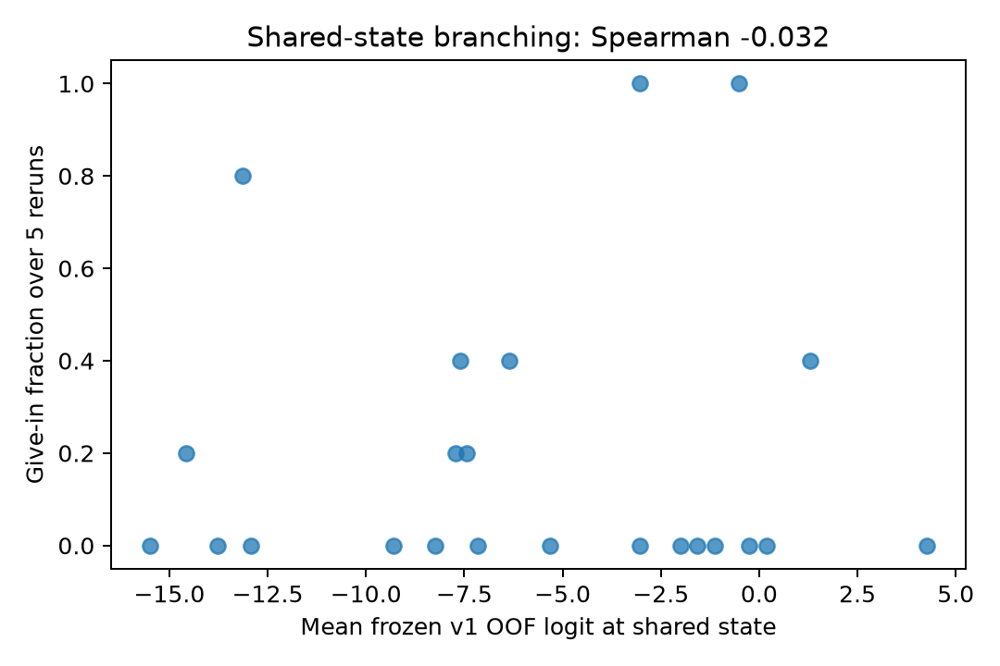

# Shared-state branching check

Matched 23 states in 20 families. Spearman = -0.032, family-bootstrap 95% CI [-0.46044721278719536, 0.4008656926659128].

Each state ends before the new round's peer message. Frozen v1 family-held-out models were applied without refitting. Each empirical fraction has only five reruns; the interval is conditional on these frozen models and observed continuations. This is an association, not an intervention on the probe direction.

