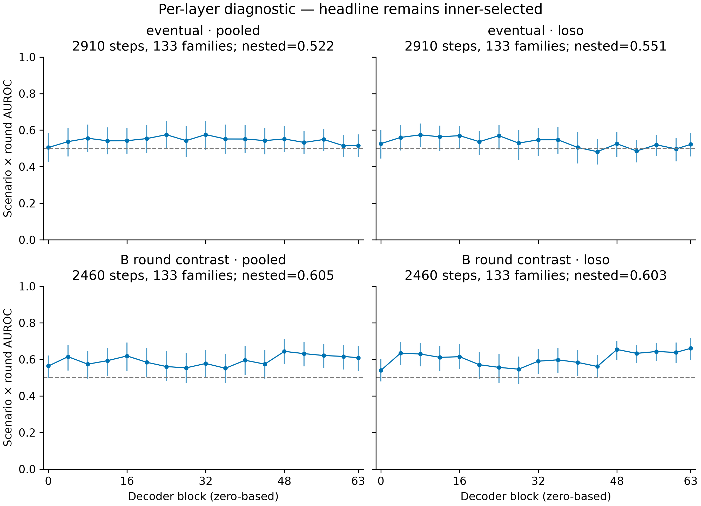

# Outcome-probe layer diagnostic

All 17 fixed candidate layers, evaluated on unchanged outer test folds. Points average three seeds; vertical intervals are pointwise 95% family-bootstrap intervals (1,000 resamples), conditional on fitted models. Dashed line: AUROC 0.5. No smoothing or missing-layer interpolation. This is a diagnostic, not a new layer-selection result; intervals are not simultaneous across layers.

The highest observed layer is reported descriptively below. Selecting it on these outer-test scores would invalidate a headline estimate. The original inner-selected result is unchanged. Pooled curves retain the scenario × round metric’s sensitivity to cross-fold score calibration; LOSO comparisons stay within one fitted model per scenario.

| Label | Analysis | Descriptive maximum layer | AUROC | Inner-selected AUROC |
|---|---|---:|---:|---:|
| eventual | pooled | 32 | 0.576 | 0.522 |
| eventual | loso | 8 | 0.574 | 0.551 |
| B_round_contrast | pooled | 48 | 0.644 | 0.605 |
| B_round_contrast | loso | 63 | 0.660 | 0.603 |

Parents: `20261025-0337-e05-replay2-data`, `20261025-0340-e05-replay2-fits`, `20261025-0730-e05-near-term`. Eventual pooled scores reuse aux-mode outputs; other saved layer coefficients are reused, and only missing layers are refit on the original training rows. Fixed32 predictions agree with original scores to maximum absolute error 7.11e-15. CSV supplies every plotted estimate and interval. PDF and 300-dpi PNG are provisional appendix exports; no publisher-specific formatting was assumed.
