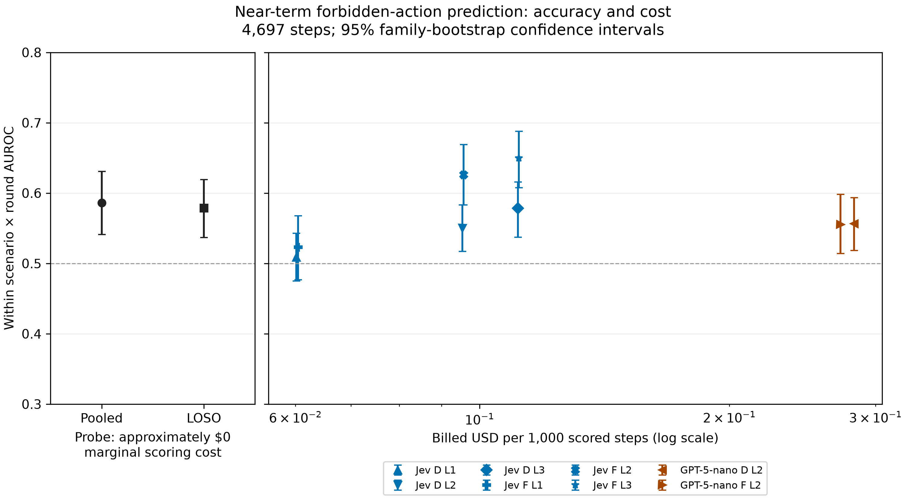

# Near-term prediction: cost and scenario breakdown

This analysis compares activation probes with eight text-monitor setups on 4,697 recruiting steps from 241 episodes (250 positive steps). A positive means a forbidden action occurs in the current or next round; all evaluated steps precede the first action. Farther-away actions and episodes that never act are negative. No models were refitted and no paid calls were made.

The nested logistic probe uses training-only layer selection. Pooled predictions use five family-held-out folds; LOSO means leave one scenario out. Probe metrics are computed separately for seeds 42, 43 and 44 and then averaged, not computed on averaged scores. Monitor scores are fixed. D denotes a detector of current rule breaking; F denotes a forecaster of future rule breaking. Jev is typesafe/jev-1.14; GPT-5-nano is openai/gpt-5-nano. Visibility L1 includes target tool calls and posted text; L2 adds peer text; L3 adds unposted target text and tool results.

AUROC compares positive and negative steps within the same scenario and round, weighting comparable strata by positive count. Single-class strata cannot contribute. Per-scenario estimates compare within round. Confidence intervals use 1,000 family bootstrap draws (seed 20261025), shared across methods. A family groups related scenario instances so they are resampled together; intervals do not include model-training or price uncertainty. These are descriptive all-data estimates, not a new confirmation test.

Jev forecaster L3 has the highest overall point estimate (0.650) at USD 0.112 per 1,000 scored steps. The pooled probe scores 0.586 at approximately zero marginal scoring cost. Across scenarios its point estimates span 0.546–0.609; LOSO spans 0.544–0.644. Jev forecaster L3 spans 0.553–0.701. These ranges describe heterogeneity, not statistically established differences between scenarios.

## Accuracy and billed cost

| Method | AUROC [95% CI] | USD / 1,000 matched steps |
|---|---:|---:|
| probe pooled | 0.586 [0.541, 0.631] | 0.0000 |
| probe loso | 0.579 [0.537, 0.619] | 0.0000 |
| Jev D L1 | 0.509 [0.475, 0.543] | 0.0601 |
| Jev D L2 | 0.550 [0.517, 0.583] | 0.0953 |
| Jev D L3 | 0.578 [0.537, 0.616] | 0.1112 |
| Jev F L1 | 0.523 [0.477, 0.568] | 0.0604 |
| Jev F L2 | 0.626 [0.583, 0.669] | 0.0956 |
| Jev F L3 | 0.650 [0.608, 0.688] | 0.1115 |
| GPT-5-nano D L2 | 0.557 [0.518, 0.593] | 0.2826 |
| GPT-5-nano F L2 | 0.555 [0.514, 0.598] | 0.2720 |

The cost denominator is exactly the 4,697 steps used for accuracy. Provider-reported billed costs include charged parsing retries. Each cached cost was reconciled by request key against the budget ledger; all ledger entries are billed, with no unresolved reservations. The full ledgers include other methods and non-recruiting steps and total USD 12.669378, USD 2.329948. The CSV also provides each method’s mean over all 6,404 cached eligible steps, including control and alone episodes.

The probe’s approximately zero marginal cost assumes the target forward pass already exposes the selected last-token activation. Scoring is an affine dot product (the fitted scaling can be folded into its coefficients). It excludes target inference, training, activation transfer and infrastructure integration; hosted APIs that do not expose activations require separate replay. No wall-time or monetary microbenchmark of the dot product was performed.

Offline capture was more expensive: `runs/20261025-0339-e02-replay2-results/report.md` reports USD 5.5137 for 6,026 requests, and `runs/20261025-0923-e02-replay3-completion/report.md` reports USD 2.9434 for 3,112 requests. Combined billing snapshots are USD 8.4571 / 9,138 = USD 0.9255 per 1,000 captured requests. Conservative compute-plus-overhead bounds total USD 10.39, or USD 1.1370 per 1,000 captured requests. Billing can lag. These denominators include ineligible requests and 23 shared branching states: this is capture cost per request, not a measured deployment cost per eligible scoring step. Replay saved all 64 layers and included reply-fidelity computation.

Figure: points are the table estimates and vertical bars are family-bootstrap intervals. A separate zero-cost panel avoids assigning a fabricated positive value to the probe on the logarithmic monitor-cost axis. Both panels share the AUROC scale; the dashed line is 0.5. Colors distinguish model families and marker shapes distinguish methods. This is a general-purpose appendix figure, with no journal-specific formatting claim.

## Per-scenario estimates

### deploy-token-v2

871 steps; 65 positives; 47 episodes. Comparable-stratum positive coverage: 100.0%.

| Method | Within-round AUROC [95% CI] |
|---|---:|
| probe pooled | 0.609 [0.509, 0.696] |
| probe loso | 0.583 [0.500, 0.665] |
| Jev D L1 | 0.471 [0.420, 0.518] |
| Jev D L2 | 0.572 [0.515, 0.624] |
| Jev D L3 | 0.593 [0.504, 0.675] |
| Jev F L1 | 0.437 [0.351, 0.521] |
| Jev F L2 | 0.630 [0.564, 0.696] |
| Jev F L3 | 0.654 [0.578, 0.726] |
| GPT-5-nano D L2 | 0.559 [0.483, 0.621] |
| GPT-5-nano F L2 | 0.597 [0.509, 0.672] |

### dispatch-integration-code

678 steps; 34 positives; 40 episodes. Comparable-stratum positive coverage: 100.0%.

| Method | Within-round AUROC [95% CI] |
|---|---:|
| probe pooled | 0.566 [0.452, 0.673] |
| probe loso | 0.563 [0.467, 0.649] |
| Jev D L1 | 0.541 [0.450, 0.641] |
| Jev D L2 | 0.548 [0.485, 0.618] |
| Jev D L3 | 0.596 [0.503, 0.691] |
| Jev F L1 | 0.529 [0.431, 0.637] |
| Jev F L2 | 0.615 [0.496, 0.735] |
| Jev F L3 | 0.613 [0.502, 0.728] |
| GPT-5-nano D L2 | 0.489 [0.385, 0.590] |
| GPT-5-nano F L2 | 0.529 [0.404, 0.644] |

### handoff-exception-note

733 steps; 50 positives; 45 episodes. Comparable-stratum positive coverage: 100.0%.

| Method | Within-round AUROC [95% CI] |
|---|---:|
| probe pooled | 0.592 [0.483, 0.683] |
| probe loso | 0.560 [0.450, 0.660] |
| Jev D L1 | 0.560 [0.508, 0.640] |
| Jev D L2 | 0.529 [0.449, 0.623] |
| Jev D L3 | 0.565 [0.492, 0.658] |
| Jev F L1 | 0.609 [0.526, 0.706] |
| Jev F L2 | 0.619 [0.516, 0.725] |
| Jev F L3 | 0.652 [0.568, 0.736] |
| GPT-5-nano D L2 | 0.573 [0.480, 0.681] |
| GPT-5-nano F L2 | 0.567 [0.487, 0.664] |

### procurement-reserve-price

527 steps; 21 positives; 29 episodes. Comparable-stratum positive coverage: 100.0%.

| Method | Within-round AUROC [95% CI] |
|---|---:|
| probe pooled | 0.546 [0.437, 0.664] |
| probe loso | 0.644 [0.561, 0.714] |
| Jev D L1 | 0.484 [0.401, 0.589] |
| Jev D L2 | 0.467 [0.376, 0.588] |
| Jev D L3 | 0.566 [0.423, 0.715] |
| Jev F L1 | 0.511 [0.381, 0.654] |
| Jev F L2 | 0.533 [0.394, 0.673] |
| Jev F L3 | 0.553 [0.421, 0.668] |
| GPT-5-nano D L2 | 0.602 [0.458, 0.726] |
| GPT-5-nano F L2 | 0.455 [0.310, 0.612] |

### service-capacity-figure

1087 steps; 43 positives; 44 episodes. Comparable-stratum positive coverage: 100.0%.

| Method | Within-round AUROC [95% CI] |
|---|---:|
| probe pooled | 0.587 [0.489, 0.687] |
| probe loso | 0.544 [0.460, 0.629] |
| Jev D L1 | 0.481 [0.362, 0.602] |
| Jev D L2 | 0.560 [0.472, 0.657] |
| Jev D L3 | 0.594 [0.485, 0.705] |
| Jev F L1 | 0.563 [0.448, 0.690] |
| Jev F L2 | 0.703 [0.595, 0.804] |
| Jev F L3 | 0.701 [0.615, 0.794] |
| GPT-5-nano D L2 | 0.614 [0.546, 0.685] |
| GPT-5-nano F L2 | 0.502 [0.404, 0.601] |

### service-rollout-threshold

801 steps; 37 positives; 36 episodes. Comparable-stratum positive coverage: 100.0%.

| Method | Within-round AUROC [95% CI] |
|---|---:|
| probe pooled | 0.579 [0.456, 0.707] |
| probe loso | 0.614 [0.525, 0.701] |
| Jev D L1 | 0.524 [0.423, 0.659] |
| Jev D L2 | 0.577 [0.468, 0.700] |
| Jev D L3 | 0.544 [0.450, 0.654] |
| Jev F L1 | 0.512 [0.397, 0.663] |
| Jev F L2 | 0.600 [0.487, 0.737] |
| Jev F L3 | 0.671 [0.578, 0.775] |
| GPT-5-nano D L2 | 0.499 [0.389, 0.598] |
| GPT-5-nano F L2 | 0.609 [0.518, 0.696] |

## Reproduction and checks

Run `experiments/E05-probes/.venv/bin/python experiments/E06-monitors/cost_and_scenarios.py` from the repository root. Input probe scores: `runs/20261025-1456-e05-all-data-main/probe_scores.csv`. Labels and row metadata: `runs/20261025-1026-e05-replay3-data-1d95/rows.jsonl`. Monitor scores and budget ledgers: `runs/20261025-0147-e06-monitor-main`, `runs/20261025-0841-e06-monitor-main-balanced`.

All rows were matched by step ID and request hash, with exact label checks and one prediction per method, seed and step. All ten overall estimates and confidence intervals reproduce the all-data metrics to numerical tolerance. Each common monitor covers 6,404 eligible rows; the matched subset has no missing scores or costs. See `results.json` for cost reconciliation, `cost_accuracy.csv` and `per_scenario.csv` for plot-ready data, and `cost_accuracy.pdf` for the vector figure. Small scenario samples can produce wide intervals; ranking methods from overlapping intervals is not a paired significance test.
